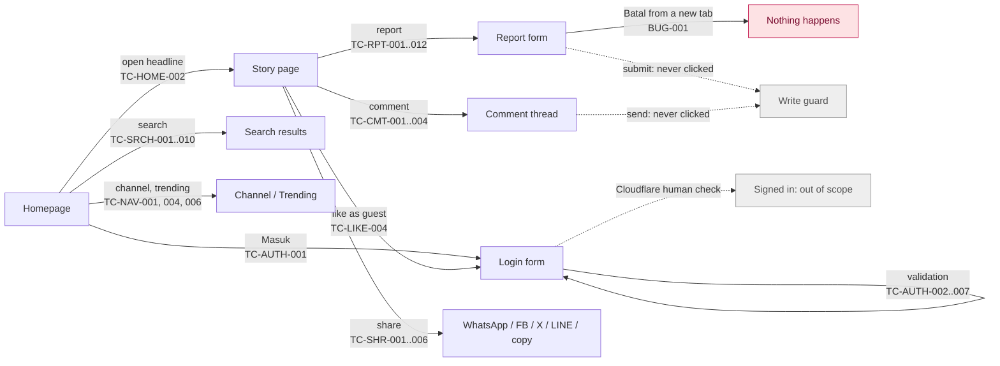
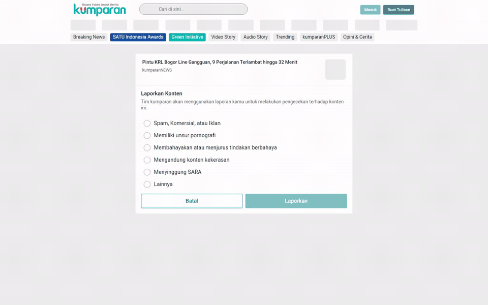
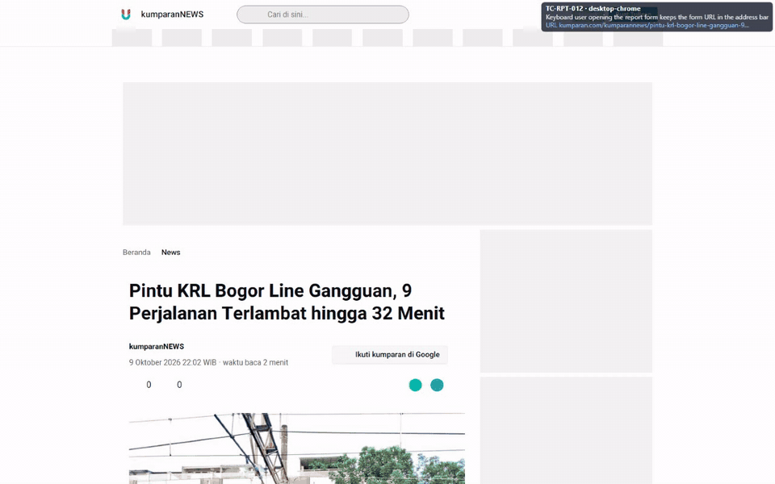
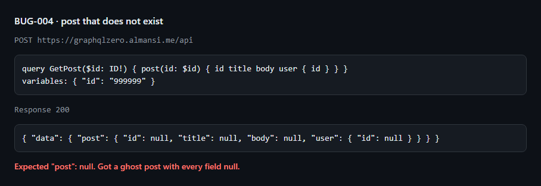
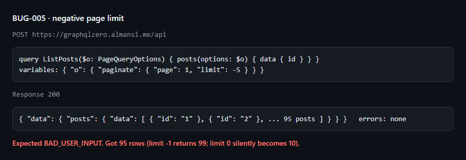
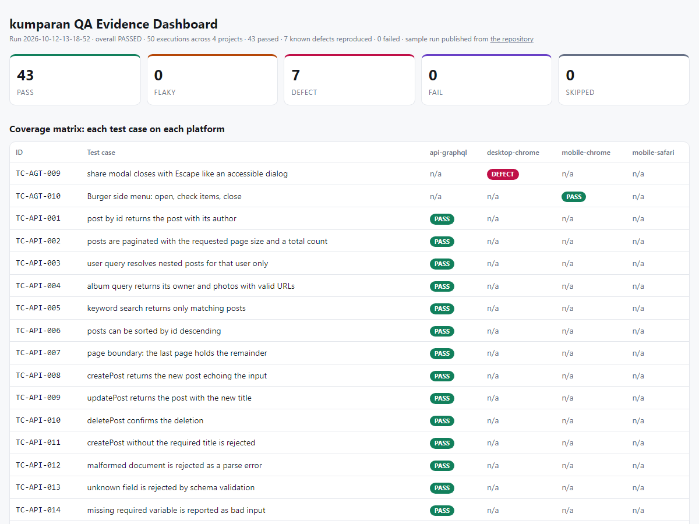
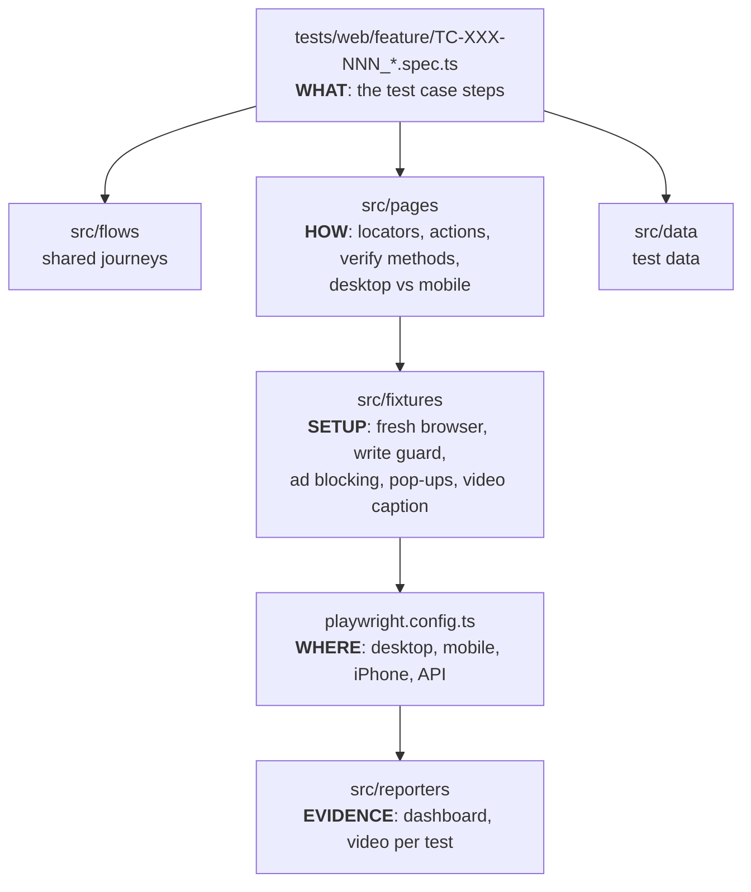

<div align="center">

# kumparan QA Automation

**Risk-based testing and Playwright automation for kumparan.com: desktop, mobile and GraphQL**

[](https://github.com/frosteve665/kumparan-qa-automation/actions/workflows/e2e.yml)


**[Live sample report](https://frosteve665.github.io/kumparan-qa-automation/sample-report/)** ·
[Test cases](docs/test-cases.md) ·
[Bug reports](docs/bugs) ·
[Test plan](docs/test-plan.md) ·
[Findings](docs/findings.md)

</div>

<table>
<tr>
<td width="70%"><br><sub><b>Desktop · TC-RPT-001</b>: a test opens a story's report form and checks all six reasons. The caption shows the test case, the step and the live URL.</sub></td>
<td width="30%"><br><sub><b>Mobile · TC-NAV-002</b>: the same suite on m.kumparan.com opens and closes the side menu.</sub></td>
</tr>
</table>

## At a glance

| 85 test cases | 169 runs per regression | 6 bugs found | 2 sites + 1 API | 0 failed · 0 flaky |
|:---:|:---:|:---:|:---:|:---:|
| risk-based, P1–P3 | desktop, mobile, iPhone, GraphQL | each with video or response evidence | kumparan.com · m.kumparan.com · GraphQLZero | latest full run, about 4 min |

This repository answers the **kumparan QA Engineer skill test**: test design and execution (Task A),
Playwright website automation (Task B), Playwright Agent automation (Task C) and GraphQL API
automation (Task D). [How each requirement is met](#how-the-brief-is-answered) is mapped below.

## What was tested

| Target | What | How |
|---|---|---|
| **kumparan.com** (desktop) | Home feed, stories, like, comment, report, share, search, login form, navigation | Desktop Chrome 1440x900 |
| **m.kumparan.com** (mobile) | The same functions on the separate mobile site | Pixel 7 (Chrome) for every test, iPhone 15 (Safari engine) for smoke tests |
| **GraphQLZero** | Queries, mutations, errors, boundaries, security | Playwright `request`, GraphQL variables only |

Rules from the brief that shape the suite: comments and reports are **never submitted** (checked up
to the submit button, and a network guard blocks any submission). A real sign-in is **out of
scope**: kumparan's login needs a person to pass Cloudflare's "Verify you are human" check.
[Why, and what is covered instead](docs/test-plan.md#out-of-scope).

## Tech stack

| | |
|---|---|
| **Test framework** | [Playwright](https://playwright.dev) 1.64 with TypeScript (strict) |
| **AI test generation** | Playwright Agents (planner, generator, healer) run in Claude Code |
| **API contracts** | [zod](https://zod.dev) schemas for GraphQL responses |
| **Reporting** | Custom evidence dashboard (video per test), Playwright HTML report, GitHub Actions summary |
| **Docs** | Test case catalog in TypeScript that generates Markdown and Excel ([ExcelJS](https://github.com/exceljs/exceljs)) |
| **Code quality** | Prettier, `tsc --noEmit`, GitHub Actions CI |
| **Runtime** | Node.js 22, Chromium and WebKit |

## User stories

Each test case traces back to something a reader (or an API client) needs to do.

| As a... | I want to... | Test cases |
|---|---|---|
| reader | open the homepage and read a story, on desktop or my phone | [Home feed](#home-feed) (3) · [Article view](#article-view) (5) |
| reader | search for news and narrow down the results | [Search](#search) (10) |
| reader | share a story to WhatsApp, Facebook, X, LINE or copy its link | [Share](#share) (6) |
| reader | like a story, and be asked to log in first if I am a guest | [Like](#like) (1) |
| reader | read the comment thread and start a comment | [Comment](#comment) (3) |
| reader | report a story that breaks the rules, with a clear reason | [Report](#report) (12) |
| reader | log in, and get a clear message if I typed something wrong | [Authentication](#authentication) (7) |
| reader | find my way around: channels, trending, side menu, dark mode | [Navigation & preferences](#navigation--preferences) (6) |
| API client | get correct data and clear errors from the GraphQL API | [GraphQL API](#graphql-api-task-d) (19) |

Playwright's agents automated 21 of these cases a second time, on both sites:
[Agent-generated](#agent-generated-task-c) (13).

## Tested user flows



## Bugs found

Every bug was reproduced by hand and then **re-verified in Google Chrome without ad blocking or any
test setup**. Each one also has an automated check that keeps failing while the bug exists and turns
red the day it is fixed.

### BUG-001 · "Batal" does nothing on a report link opened in a new tab


A reader who opens a shared report link in a new tab taps **Batal** and nothing happens (watch the
URL line in the caption stay on `/report/story/`). Readers arriving from another website are sent
back to it. "Batal" only goes back in browser history. Desktop and mobile, **Medium**.
[Full report](docs/bugs/BUG-001.md)

### BUG-002 · The address bar shows the story while the report form is open


A keyboard user opens the report form ("Laporkan tulisan", Enter): the form is shown but the URL
switches back to the story, so refreshing or sharing leads somewhere else. About 9 in 10 keyboard
openings; normal scrolling never triggers it. Desktop, **Low**. [Full report](docs/bugs/BUG-002.md)

### BUG-003 · React error #418 on every desktop homepage load


The server-rendered page does not match what the browser renders (React error #418), so React
throws it away and renders again: the page responds to taps late. Desktop, **Medium**.
[Full report](docs/bugs/BUG-003.md)

### BUG-006 · The share pop-up ignores Escape and is not an accessible dialog


Escape does nothing, there is no `role="dialog"`, and focus is not moved into the pop-up: a keyboard
user needs 24 Tab presses to reach its close button. Found by the Playwright healer agent. Desktop
and mobile, **Medium (accessibility)**. [Full report](docs/bugs/BUG-006.md)

### BUG-004 · API: a post that does not exist comes back as an empty post


[Full report](docs/bugs/BUG-004.md) · **Medium**

### BUG-005 · API: negative page limits are accepted


[Full report](docs/bugs/BUG-005.md) · **Medium**

Six observations that are not filed as bugs (for example, a guest can type a whole comment with no
login prompt) are listed in [findings.md](docs/findings.md).

## Evidence report

<a href="https://frosteve665.github.io/kumparan-qa-automation/sample-report/"></a>

**[Open the live sample report](https://frosteve665.github.io/kumparan-qa-automation/sample-report/)**:
a real run of 50 tests (smoke tests on all platforms, every bug check, the full API suite). Every web
test has a video you can play in the page, with the test case, step and URL shown inside it.

Every run writes the same report locally to `reports/index.html`. Results are labelled **PASS**,
**FLAKY** (passed only on retry, never hidden), **DEFECT** (a known kumparan bug still reproducing),
**FAIL** (a network or test problem) or **SKIPPED** (with the reason).

## How the brief is answered

<details>
<summary><b>Scenario rules</b></summary>

| Rule | How it is covered |
|---|---|
| Active accounts can log in and log out; invalid accounts get a clear message | Login entry, form and messages are automated: empty form blocked, malformed email shows *"Harus diisi dengan format email"*, empty password shows *"Tidak boleh kosong"* (TC-AUTH-001 to 007). A real sign-in and logout are out of scope: kumparan's Cloudflare check needs a person and must not be bypassed. The check itself is asserted (TC-AUTH-005). |
| View, share, like, comment, report; never submit comments or reports | View (TC-ART), share (TC-SHR), like (TC-LIKE), comment (TC-CMT), report (TC-RPT). Checked up to the submit button only; a network guard fails any test that tries to submit. |
| Core functions work on desktop and mobile despite different layouts | Each website test file runs on kumparan.com and m.kumparan.com; page objects handle the layout differences. Features that exist on one site only are tested where they exist. |

</details>

<details>
<summary><b>Task A: test cases and risk analysis</b></summary>

| Requirement | Where |
|---|---|
| Test cases for desktop and mobile with priority | [test-cases.md](docs/test-cases.md) / [Excel](docs/test-cases.xlsx): 85 cases, P1–P3, each with the risk it covers |
| Happy paths, negative, boundaries | Every module mixes Positive / Negative / Boundary / Edge cases |
| Exploratory | 5 charters in the [test plan](docs/test-plan.md), plus a crawler that clicked 183 buttons and links on both sites ([flow digest](knowledge/flow-digest.md), [feature maps](docs/features)) |
| Authorization | What a guest can and cannot do: TC-LIKE-004, TC-CMT-004, TC-RPT-007, TC-AGT-008 |
| Error handling | TC-ART-004 (404), TC-RPT-008, TC-AGT-008, TC-API-012 to 015 |
| State changes | TC-RPT-002/003/010/011 (report state), TC-NAV-003 (theme), TC-SRCH-003 (sort), TC-NAV-002 (side menu) |
| Data validation | TC-ART-002, TC-CMT-002 (counters), TC-SHR-001/004/005 (share links), TC-SRCH-008 to 010 (encoding), API contracts |
| Assumptions, out of scope, dependencies, data needs, exit criteria | [test-plan.md](docs/test-plan.md), sections 1, 4, 5, 6 and 9 |
| Execute and report findings | [findings.md](docs/findings.md) and [6 bug reports](docs/bugs) |

</details>

<details>
<summary><b>Task B: Playwright website tests</b></summary>

| Requirement | Where |
|---|---|
| Automate the Task A cases for desktop and mobile | [tests/web/](tests/web): 53 cases, one file per case named by its ID |
| Fixtures or setup to isolate data and state | [src/fixtures](src/fixtures/index.ts): fresh browser per test, injected page objects, a live story per worker, network guard, ad blocking, pop-up handling |
| Parallel execution, data cleanup, timeouts, retries, flaky tests | [automation-strategy.md](docs/automation-strategy.md) |
| `data-qa-id` locators, creative when missing | `testIdAttribute: 'data-qa-id'`; documented fallbacks in the page objects (e.g. the comment box `textarea#comment-editor`) |

</details>

<details>
<summary><b>Task C: Playwright Agent</b></summary>

| Requirement | Where |
|---|---|
| Automate the Task A cases with Playwright Agent, desktop and mobile | [tests/agent/](tests/agent): 13 tests from the planner, generator and healer, automating 21 Task A cases ([traceability](docs/test-cases.md#task-c-traceability-task-a-cases-automated-by-playwright-agent)) |
| Agent explores the site | Plans written by the planner after exploring the live site: [specs/](specs) |
| Prompts used | [docs/agent-prompts.md](docs/agent-prompts.md), also runnable from `.claude/prompts/` |
| Proper assertions, easy to maintain | Reviewed and stress-tested ([REVIEW.md](tests/agent/REVIEW.md)); same fixtures and page objects as Task B |

</details>

<details>
<summary><b>Task D: Playwright API (GraphQL)</b></summary>

| Requirement | Where |
|---|---|
| At least 5 queries | 7 queries in [queries.spec.ts](tests/api/graphql/queries.spec.ts) |
| Playwright `request` / APIRequestContext | [graphql-client.ts](src/api/graphql-client.ts) |
| Queries and negative tests | 8 negative, boundary and security tests in [negative.spec.ts](tests/api/graphql/negative.spec.ts) |
| Authorization and mutations (if the endpoint has auth) | GraphQLZero has no authentication; mutations are covered anyway in [mutations.spec.ts](tests/api/graphql/mutations.spec.ts) |
| Inputs as variables, no string concatenation | Operations are constants in [operations.ts](src/api/operations.ts); TC-API-016 proves an injection-shaped value stays data |
| Validate status, `data` and `errors` | Every test checks all three; zod checks the response shape |

</details>

## All test cases

Generated from [test-design/catalog.ts](test-design/catalog.ts) with the latest full-run result
(`D` desktop, `M` mobile, `S` iPhone Safari, `A` API). Steps and expected results for every case are
in [test-cases.md](docs/test-cases.md) and the [Excel sheet](docs/test-cases.xlsx).

<!-- TEST-CASES:START -->
### Home feed

<details><summary>3 cases · 2 P1</summary>

| ID | Test case | Type | Priority | Result |
|---|---|---|---|---|
| [TC-HOME-001](tests/web/home/TC-HOME-001_Homepage_Loads.spec.ts) | Homepage loads with header, headlines and story cards | Positive | P1 | ✅ D · ✅ M · ✅ S |
| [TC-HOME-002](tests/web/home/TC-HOME-002_Headline_Opens_Article.spec.ts) | Opening a headline navigates to its article | Positive | P1 | ✅ D · ✅ M · ✅ S |
| [TC-HOME-003](tests/web/home/TC-HOME-003_Usable_With_Ads_On.spec.ts) | Homepage stays usable with real ads enabled | Edge | P2 | ✅ D · ✅ M |

</details>

### Authentication

<details><summary>7 cases · 3 P1</summary>

| ID | Test case | Type | Priority | Result |
|---|---|---|---|---|
| [TC-AUTH-001](tests/web/auth/TC-AUTH-001_Login_Entry_Opens_Form.spec.ts) | Login entry point opens the login form | Positive | P1 | ✅ D · ✅ M · ✅ S |
| [TC-AUTH-002](tests/web/auth/TC-AUTH-002_Submit_Disabled_When_Empty.spec.ts) | Submit stays disabled while email and password are empty | Negative | P1 | ✅ D · ✅ M |
| [TC-AUTH-003](tests/web/auth/TC-AUTH-003_Malformed_Email_Rejected.spec.ts) | Malformed email is rejected with a format message (4 data rows) | Negative | P1 | ✅ D · ✅ M |
| [TC-AUTH-004](tests/web/auth/TC-AUTH-004_Cleared_Password_Required.spec.ts) | Clearing the password shows a required-field message | Boundary | P2 | ✅ D · ✅ M |
| [TC-AUTH-005](tests/web/auth/TC-AUTH-005_Bot_Challenge_Before_Submit.spec.ts) | Login is protected by a bot challenge before submit | Negative | P2 | ✅ D · ✅ M |
| [TC-AUTH-006](tests/web/auth/TC-AUTH-006_Password_Visibility_Toggle.spec.ts) | Password visibility toggle reveals and hides the password | Edge | P3 | ✅ D · ✅ M |
| [TC-AUTH-007](tests/web/auth/TC-AUTH-007_Alternative_Sign_In_Options.spec.ts) | Alternative sign-in methods and recovery links are offered | Positive | P3 | ✅ D · ✅ M |

</details>

### Article view

<details><summary>5 cases · 2 P1</summary>

| ID | Test case | Type | Priority | Result |
|---|---|---|---|---|
| [TC-ART-001](tests/web/article/TC-ART-001_Story_Content_Shown.spec.ts) | Article shows title, byline, date and body | Positive | P1 | ✅ D · ✅ M · ✅ S |
| [TC-ART-002](tests/web/article/TC-ART-002_Engagement_Bar_Shown.spec.ts) | Engagement bar offers like, comment and share with numeric counters | Positive | P1 | ✅ D · ✅ M · ✅ S |
| [TC-ART-003](tests/web/article/TC-ART-003_Title_And_Canonical_Match_Story.spec.ts) | Page title and canonical URL identify the story | Positive | P2 | ✅ D · ✅ M |
| [TC-ART-004](tests/web/article/TC-ART-004_Unknown_Story_Returns_404.spec.ts) | Unknown story URL returns 404 and keeps site navigation | Negative | P2 | ✅ D · ✅ M |
| [TC-ART-005](tests/web/article/TC-ART-005_Breadcrumb_Returns_Home.spec.ts) | Breadcrumb Home returns to the homepage | Positive | P3 | ✅ D · ✅ M |

</details>

### Like

<details><summary>1 cases · 1 P1</summary>

| ID | Test case | Type | Priority | Result |
|---|---|---|---|---|
| [TC-LIKE-004](tests/web/like/TC-LIKE-004_Guest_Like_Redirects_To_Login.spec.ts) | Guest who taps like is sent to login and the count does not change | Negative | P1 | ✅ D · ✅ M |

</details>

### Comment

<details><summary>3 cases · 2 P1</summary>

| ID | Test case | Type | Priority | Result |
|---|---|---|---|---|
| [TC-CMT-001](tests/web/comment/TC-CMT-001_Comment_Button_Opens_Thread.spec.ts) | Comment button opens the story comment thread | Positive | P1 | ✅ D · ✅ M · ✅ S |
| [TC-CMT-002](tests/web/comment/TC-CMT-002_Comment_Count_Matches_Thread.spec.ts) | Comment count on the article matches the thread | Positive | P2 | ✅ D · ✅ M |
| [TC-CMT-004](tests/web/comment/TC-CMT-004_Guest_Draft_Publishes_Nothing.spec.ts) | Guest typing a comment publishes nothing | Negative | P1 | ✅ D · ✅ M |

</details>

### Report

<details><summary>12 cases · 4 P1</summary>

| ID | Test case | Type | Priority | Result |
|---|---|---|---|---|
| [TC-RPT-001](tests/web/report/TC-RPT-001_Report_Form_Shows_Six_Reasons.spec.ts) | Report opens "Laporkan Konten" with six reasons | Positive | P1 | ✅ D · ✅ M |
| [TC-RPT-002](tests/web/report/TC-RPT-002_Each_Reason_Enables_Submit.spec.ts) | Each of reasons 1-5 can be selected and enables submit (5 data rows) | Positive | P1 | ✅ D · ✅ M |
| [TC-RPT-003](tests/web/report/TC-RPT-003_Submit_Disabled_Without_Reason.spec.ts) | Submit stays disabled until a reason is chosen | Negative | P1 | ✅ D · ✅ M |
| [TC-RPT-004](tests/web/report/TC-RPT-004_Cancel_Returns_To_Story.spec.ts) | Cancel from the story returns to the story without reporting | Negative | P2 | ✅ D · ✅ M |
| [TC-RPT-005](tests/web/report/TC-RPT-005_Only_One_Reason_Selected.spec.ts) | Only one reason can be selected at a time | Boundary | P2 | ✅ D · ✅ M |
| [TC-RPT-006](tests/web/report/TC-RPT-006_Other_Reveals_Text_Field.spec.ts) | "Lainnya" reveals a free-text field | Edge | P3 | ✅ D · ✅ M |
| [TC-RPT-007](tests/web/report/TC-RPT-007_Guest_Reaches_Enabled_Submit.spec.ts) | Guest can complete the report form up to submit | Edge | P1 | ✅ D · ✅ M |
| [TC-RPT-008](tests/web/report/TC-RPT-008_Missing_Story_Handled.spec.ts) | Report link for a missing story is handled cleanly | Edge | P3 | ✅ D · ✅ M |
| [TC-RPT-009](tests/web/report/TC-RPT-009_Cancel_In_New_Tab_Leaves_Form.spec.ts) | "Batal" on a report link opened in a new tab takes the reader out of the form ([BUG-001](docs/bugs/BUG-001.md)) | Edge | P2 | 🐞 D · 🐞 M |
| [TC-RPT-010](tests/web/report/TC-RPT-010_Other_Empty_Cannot_Submit.spec.ts) | "Lainnya" with an empty reason cannot be submitted | Boundary | P2 | ✅ D · ✅ M |
| [TC-RPT-011](tests/web/report/TC-RPT-011_Other_With_Text_Can_Submit.spec.ts) | "Lainnya" becomes submittable once a reason is written | Boundary | P2 | ✅ D · ✅ M |
| [TC-RPT-012](tests/web/report/TC-RPT-012_Keyboard_Report_Keeps_Form_Url.spec.ts) | Keyboard user opening the report form keeps the form URL in the address bar ([BUG-002](docs/bugs/BUG-002.md)) | Edge | P3 | 🐞 D |

</details>

### Share

<details><summary>6 cases · 2 P1</summary>

| ID | Test case | Type | Priority | Result |
|---|---|---|---|---|
| [TC-SHR-001](tests/web/share/TC-SHR-001_WhatsApp_Share_Carries_Story.spec.ts) | WhatsApp share carries the headline and the story link | Positive | P1 | ✅ D · ✅ M |
| [TC-SHR-002](tests/web/share/TC-SHR-002_Share_Menu_Lists_Channels.spec.ts) | Share menu lists every share channel | Positive | P2 | ✅ D · ✅ M |
| [TC-SHR-003](tests/web/share/TC-SHR-003_Copy_Link_Copies_Story.spec.ts) | Copy link puts the story link on the clipboard and confirms it | Positive | P1 | ✅ D · ✅ M |
| [TC-SHR-004](tests/web/share/TC-SHR-004_Menu_Shares_Carry_Story.spec.ts) | Facebook, X and LINE shares carry the story link (3 data rows) | Positive | P2 | ✅ D · ✅ M |
| [TC-SHR-005](tests/web/share/TC-SHR-005_Shared_Links_Are_Absolute.spec.ts) | Shared links are absolute https URLs on kumparan.com | Edge | P3 | ✅ D · ✅ M |
| [TC-SHR-006](tests/web/share/TC-SHR-006_Share_Menu_Closes.spec.ts) | Share menu closes with its close button | Edge | P3 | ✅ D · ✅ M |

</details>

### Search

<details><summary>10 cases · 2 P1</summary>

| ID | Test case | Type | Priority | Result |
|---|---|---|---|---|
| [TC-SRCH-001](tests/web/search/TC-SRCH-001_Keyword_Returns_Relevant_Stories.spec.ts) | Keyword search from the header returns relevant stories | Positive | P1 | ✅ D · ✅ M · ✅ S |
| [TC-SRCH-002](tests/web/search/TC-SRCH-002_Tabs_Switch_Result_Type.spec.ts) | Result tabs switch the result type (5 data rows) | Positive | P2 | ✅ D · ✅ M |
| [TC-SRCH-003](tests/web/search/TC-SRCH-003_Sort_By_Newest.spec.ts) | "Terbaru" sort switches to newest-first | Positive | P2 | ✅ D · ✅ M |
| [TC-SRCH-004](tests/web/search/TC-SRCH-004_Nonsense_Keyword_Not_Found.spec.ts) | Nonsense keyword shows the "not found" state | Negative | P2 | ✅ D · ✅ M |
| [TC-SRCH-005](tests/web/search/TC-SRCH-005_Empty_Query_Stays_On_Landing.spec.ts) | Submitting an empty query stays on the search landing page | Boundary | P2 | ✅ D · ✅ M |
| [TC-SRCH-006](tests/web/search/TC-SRCH-006_One_Character_Query.spec.ts) | One-character query is accepted | Boundary | P3 | ✅ D · ✅ M |
| [TC-SRCH-007](tests/web/search/TC-SRCH-007_Long_Query_Handled.spec.ts) | 200-character query is handled without error | Boundary | P3 | ✅ D · ✅ M |
| [TC-SRCH-008](tests/web/search/TC-SRCH-008_Html_Shown_As_Text.spec.ts) | HTML typed into search is shown as text, never rendered | Edge | P1 | ✅ D · ✅ M |
| [TC-SRCH-009](tests/web/search/TC-SRCH-009_Emoji_Query_Encoded.spec.ts) | Emoji and unicode queries are encoded and searched | Edge | P3 | ✅ D · ✅ M |
| [TC-SRCH-010](tests/web/search/TC-SRCH-010_Ampersand_Query_Encoded.spec.ts) | Query with "&" is encoded, not split | Edge | P3 | ✅ D · ✅ M |

</details>

### Navigation & preferences

<details><summary>6 cases · 0 P1</summary>

| ID | Test case | Type | Priority | Result |
|---|---|---|---|---|
| [TC-NAV-001](tests/web/navigation/TC-NAV-001_Channel_Menu_Opens_News.spec.ts) | Channel menu opens the News channel | Positive | P2 | ✅ D · ✅ M |
| [TC-NAV-002](tests/web/navigation/TC-NAV-002_Mobile_Side_Menu_Opens_Closes.spec.ts) | Mobile side menu opens and closes | Positive | P2 | ✅ M |
| [TC-NAV-003](tests/web/navigation/TC-NAV-003_Dark_Mode_Survives_Reload.spec.ts) | Dark mode switches the theme and survives a reload | Positive | P3 | ✅ D · ✅ M |
| [TC-NAV-004](tests/web/navigation/TC-NAV-004_Trending_From_Load_More.spec.ts) | "Lihat lainnya" on trending opens the Trending page | Positive | P2 | ✅ D |
| [TC-NAV-005](tests/web/navigation/TC-NAV-005_No_JavaScript_Errors.spec.ts) | Homepage loads without first-party JavaScript errors ([BUG-003](docs/bugs/BUG-003.md)) | Edge | P2 | 🐞 D · ✅ M |
| [TC-NAV-006](tests/web/navigation/TC-NAV-006_Mobile_Top_Nav_Opens_Trending.spec.ts) | Mobile top-nav strip opens Trending | Positive | P2 | ✅ M |

</details>

### Agent-generated (Task C)

<details><summary>13 cases · 3 P1</summary>

| ID | Test case | Type | Priority | Result |
|---|---|---|---|---|
| [TC-AGT-001](tests/agent/search/search.agent.spec.ts) | Search a common term and switch every result tab | Positive | P2 | ✅ D |
| [TC-AGT-002](tests/agent/search/search.agent.spec.ts) | No-result term shows the empty state | Negative | P2 | ✅ D |
| [TC-AGT-003](tests/agent/search/search.agent.spec.ts) | Boundary queries: empty, 1 char, 300 chars, special characters | Boundary | P2 | ✅ D |
| [TC-AGT-004](tests/agent/search/search.agent.spec.ts) | Sort Terbaru/Relevansi and clear the query with x-circle | Edge | P3 | ✅ D |
| [TC-AGT-005](tests/agent/share/share.agent.spec.ts) | Share bar: WhatsApp popup and copy link from a headline story | Positive | P1 | ✅ D |
| [TC-AGT-006](tests/agent/share/share.agent.spec.ts) | Share menu lists channels, closes, and works for a non-ASCII headline | Edge | P2 | ✅ D |
| [TC-AGT-007](tests/agent/navigation/navigation.agent.spec.ts) | Header and sub-menu routes (Trending, Breaking News, Audio Story, More) | Positive | P2 | ✅ D |
| [TC-AGT-008](tests/agent/navigation/navigation.agent.spec.ts) | Guest notification, theme persistence across pages, invalid route | Edge | P2 | ✅ D |
| [TC-AGT-009](tests/agent/share/share.agent.spec.ts) | Share modal closes with Escape like an accessible dialog ([BUG-006](docs/bugs/BUG-006.md)) | Negative | P2 | 🐞 D |
| [TC-AGT-010](tests/agent/mobile/mobile.agent.spec.ts) | Mobile burger side menu: open, every item and link, close (x3) | Positive | P2 | ✅ M |
| [TC-AGT-011](tests/agent/mobile/mobile.agent.spec.ts) | Mobile top-nav strip routes | Positive | P2 | ✅ M |
| [TC-AGT-012](tests/agent/mobile/mobile.agent.spec.ts) | Mobile share bar and share modal | Positive | P1 | ✅ M |
| [TC-AGT-013](tests/agent/mobile/mobile.agent.spec.ts) | Mobile guest login entry from the side menu (form only, never submitted) | Positive | P1 | ✅ M |

</details>

### GraphQL API (Task D)

<details><summary>19 cases · 11 P1</summary>

| ID | Test case | Type | Priority | Result |
|---|---|---|---|---|
| [TC-API-001](tests/api/graphql/queries.spec.ts) | post(id) returns the post with its author | Positive | P1 | ✅ A |
| [TC-API-002](tests/api/graphql/queries.spec.ts) | posts paginate with page size and total count | Positive | P1 | ✅ A |
| [TC-API-003](tests/api/graphql/queries.spec.ts) | user query resolves nested posts for that user only | Positive | P1 | ✅ A |
| [TC-API-004](tests/api/graphql/queries.spec.ts) | album returns owner and photos with valid URLs | Positive | P2 | ✅ A |
| [TC-API-005](tests/api/graphql/queries.spec.ts) | keyword search returns only matching posts | Positive | P2 | ✅ A |
| [TC-API-006](tests/api/graphql/queries.spec.ts) | posts sort by id descending | Positive | P3 | ✅ A |
| [TC-API-007](tests/api/graphql/queries.spec.ts) | last page holds the remainder | Boundary | P2 | ✅ A |
| [TC-API-008](tests/api/graphql/mutations.spec.ts) | createPost returns the new post echoing the input | Positive | P1 | ✅ A |
| [TC-API-009](tests/api/graphql/mutations.spec.ts) | updatePost returns the new title | Positive | P1 | ✅ A |
| [TC-API-010](tests/api/graphql/mutations.spec.ts) | deletePost confirms the deletion | Positive | P1 | ✅ A |
| [TC-API-011](tests/api/graphql/mutations.spec.ts) | createPost without the required title is rejected | Negative | P1 | ✅ A |
| [TC-API-012](tests/api/graphql/negative.spec.ts) | malformed document is a parse error | Negative | P1 | ✅ A |
| [TC-API-013](tests/api/graphql/negative.spec.ts) | unknown field fails schema validation | Negative | P1 | ✅ A |
| [TC-API-014](tests/api/graphql/negative.spec.ts) | missing required variable is bad input | Negative | P1 | ✅ A |
| [TC-API-015](tests/api/graphql/negative.spec.ts) | wrong variable type is bad input | Negative | P2 | ✅ A |
| [TC-API-016](tests/api/graphql/negative.spec.ts) | injection-shaped input travels as plain data | Edge | P1 | ✅ A |
| [TC-API-017](tests/api/graphql/negative.spec.ts) | GET without a CSRF-safe header is blocked | Negative | P2 | ✅ A |
| [TC-API-018](tests/api/graphql/negative.spec.ts) | unknown post id returns null ([BUG-004](docs/bugs/BUG-004.md)) | Boundary | P2 | 🐞 A |
| [TC-API-019](tests/api/graphql/negative.spec.ts) | negative page limit is rejected ([BUG-005](docs/bugs/BUG-005.md)) | Boundary | P2 | 🐞 A |

</details>

Result: ✅ pass · 🐞 known bug reproduced · ⚠️ passed on retry · ❌ fail.
<!-- TEST-CASES:END -->

## How to run

You need **Node.js 22+** and **git**. No account or credentials are needed.

```bash
git clone https://github.com/frosteve665/kumparan-qa-automation.git
cd kumparan-qa-automation
npm ci
npx playwright install chromium webkit

npm test                          # everything, about 4 minutes
npx playwright test --ui          # interactive: pick a test and watch every step
```

<details>
<summary><b>More commands</b></summary>

| What | Command |
|---|---|
| Desktop site only | `npm run test:desktop` |
| Mobile site only (Pixel 7 + iPhone smoke) | `npm run test:mobile` |
| GraphQL only (about 5 s) | `npm run test:api` |
| Playwright-agent tests | `npm run test:agent` |
| Smoke tests | `npx playwright test --grep "@smoke"` |
| One test case | `npx playwright test -g "TC-LIKE-004"` |
| One case on one platform, browser visible | `npx playwright test -g "TC-SHR-001" --project=desktop-chrome --headed` |
| Step-by-step debugger | `npx playwright test -g "TC-RPT-001" --project=desktop-chrome --debug` |
| Evidence dashboard | open `reports/index.html` |
| Playwright HTML report | `npm run report` |
| Regenerate test case docs (Markdown, Excel, this README's list) | `npm run docs:test-cases` |
| Regenerate README media and the sample report | `npm run docs:media` (needs ffmpeg) |
| Re-check the bugs in real Chrome | `npx tsx scripts/repro/verify-bugs.ts`, `npx tsx scripts/repro/verify-keyboard.ts` |
| Re-map the site after a UI change | `npm run explore && npm run explore:digest` |

</details>

<details>
<summary><b>Troubleshooting</b></summary>

- **Every web test is SKIPPED with "the site's firewall blocks this network":** kumparan blocks
  data-center networks such as GitHub's CI servers. Run from a normal connection. In GitHub Actions
  the API tests still run fully.
- **A test FAILs:** open its row in `reports/index.html`; the video shows the step it was on and the
  note says whether it was the network, the test, or a product bug.
- **Results vary slightly between runs:** the tests use the live site and a fresh story each run;
  retries absorb network noise and are always reported as FLAKY.

</details>

## How the framework works



A test only says **what** a reader does. Every test case has its own file
(`tests/web/like/TC-LIKE-004_Guest_Like_Redirects_To_Login.spec.ts`) and reads as its steps:

```ts
const CASE = '[TC-LIKE-004] Guest who taps like is sent to login and the count does not change';

test(CASE, { tag: ['@p1'] }, async ({ article, articlePath, login }) => {
  await article.open(articlePath);
  const likesBefore = await article.likeCount();

  await article.tapLikeAsGuest();
  await login.verifyShown();

  await article.open(articlePath);
  await article.verifyLikeCount(likesBefore);
});
```

<details>
<summary><b>What happens when a test runs</b></summary>

1. **Playwright picks the projects.** The same file runs on desktop-chrome (kumparan.com) and
   mobile-chrome (m.kumparan.com); `@smoke` tests also run on mobile-safari.
2. **The setup in `src/fixtures/` runs automatically:** a fresh browser (isolation); a check that
   kumparan is reachable from this network; the write guard (any comment or report submission is
   blocked and fails the test); ad blocking and local stand-ins for share pop-ups; a handler that
   closes the "Video Story" promo; the video caption; a live story picked from the homepage.
3. **The test body runs its steps** through page objects.
4. **The page object does the hard work:** it finds elements by `data-qa-id`, waits until kumparan's
   JavaScript has actually wired a control before using it, and handles the desktop vs mobile
   difference (for example `header.goToLogin()` opens the burger menu first on mobile).
5. **After the test** the write guard is checked; a video and a screenshot are kept for every test,
   a trace for failures.
6. **The reporter** labels the result and adds it to `reports/index.html`.

Known bugs are marked `test.fail()` with their bug ID: the run stays green while the bug exists and
the dashboard shows DEFECT; when kumparan fixes it, the test turns red as a signal to remove the marker.
Full strategy (parallelism, cleanup, timeouts, retries, flaky tests): [automation-strategy.md](docs/automation-strategy.md).

</details>

<details>
<summary><b>Project structure</b></summary>

```
src/pages/        page objects: locators at the top, then actions and verify... methods
src/flows/        multi-step journeys reused by tests
src/data/         test data per feature (no literal values in tests)
src/fixtures/     test setup: isolation, write guard, ad blocking, pop-ups, video caption
src/api/          GraphQL client (variables only) and response contracts
src/reporters/    evidence dashboard
tests/web/        Task B: one file per test case
tests/agent/      Task C: Playwright-agent tests + review notes
tests/api/        Task D: GraphQL tests
test-design/      test case catalog (source of the docs and this README's list)
scripts/          site crawler, media builder, bug re-check scripts, CI helpers
docs/             test plan, test cases, findings, bug reports, strategy, agent prompts,
                  feature maps, media, sample report
```

Adding a test case: add it to `test-design/catalog.ts`, create
`tests/web/<feature>/TC-XXX-NNN_Short_Title.spec.ts`, add any missing page-object method, run
`npx playwright test -g "TC-XXX-NNN"`, then `npm run docs:test-cases`.

</details>
