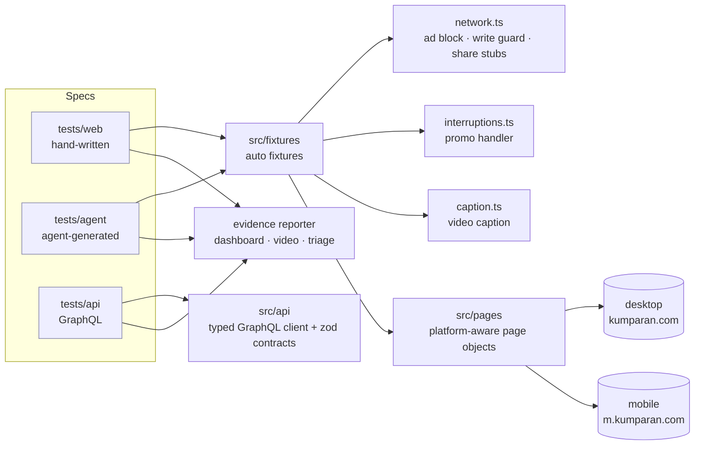

# Automation strategy (Task B)

How the suite stays isolated, parallel, fast and trustworthy against a live production site that
we do not control.

## Architecture in one picture



**One spec, two sites.** kumparan serves two different front-ends. Page objects take the platform
(from the Playwright project) and hide the differences: header button vs burger menu, inline share
icons vs share modal, header search vs `/search` page. A spec states the business behavior once
and runs on desktop Chrome, Pixel 7 and (for `@smoke`) iPhone 15 WebKit.

## Locators
1. **`data-qa-id` first.** `testIdAttribute: 'data-qa-id'` in the config, so every page object uses `getByTestId`.
2. **Role or accessible name** when no `data-qa-id` exists (e.g. the promo's "Jelajahi Sekarang" button).
3. **Stable anchors, documented in the page object**, for the few elements without either:
   - the comment editor is `textarea#comment-editor` inside `input-comment`;
   - the password toggle is "the first button after the password field" (its icon id flips `eye`/`eye-off`);
   - the report submit shares its id `btn-report` with the article's entry point, so it is scoped to the form;
   - the dark-mode switch is the checkbox in the "Mode Gelap" row.
4. The crawler's flow map (`knowledge/flow-map.json`) is the locator inventory; `knowledge/drift.md`
   reports added, removed or re-routed `data-qa-id`s between crawls, before tests fail.

## Isolation: fixtures and setup
| Concern | Mechanism |
|---|---|
| Browser state | Playwright gives every test a fresh browser context (cookies, storage, theme) |
| Page objects | Injected per test by fixtures (`home`, `article`, `report`, ...), already bound to the platform |
| Network safety | Auto fixture `network`: blocks ad hosts, stubs share popups, **guards writes** (see below) |
| Interruptions | Auto fixture `interruptions`: `page.addLocatorHandler` closes the promo modal whenever it appears |
| Test data | Worker fixture `articlePath` resolves a live story once per worker; inputs live in `src/data/*.data.ts` |
| API | `gql` fixture: a GraphQL client on Playwright's `request` fixture, one per test |

### The write guard
The brief forbids submitting comments and reports. Tests never click those buttons, and in
addition every context routes kumparan's GraphQL traffic through a guard that **aborts** any
mutation whose operation name matches comment/response/report/flag, records it, and fails the
test in fixture teardown. The same guard protects the Playwright agents (Task C) and the crawler,
which explore production on their own.

## Data and cleanup
- **Read-mostly by design.** Nothing in the guest suite writes data.
- **No account is used:** logged-in flows are out of scope (Cloudflare human check), so no test changes any user's data.
- **Comments and reports** are never submitted (write guard).
- **GraphQLZero** mutations are not persisted by the server, so they need no cleanup; tests use
  unique titles anyway (worker index) so parallel runs never collide.
- **Local artifacts**: the reporter keeps the last 5 runs (`REPORT_KEEP_RUNS`) and prunes older ones.

## Parallel execution
- `fullyParallel: true`: tests are independent (no ordering, no shared mutable state), so files
  and the tests inside them run in parallel.
- **Workers: 4 locally, 2 in CI.** The target is someone else's production behind Cloudflare: we cap
  load to stay polite and below rate limits instead of maximizing speed.
- Projects (desktop, mobile, safari smoke, api) run side by side; the API project needs no browser.
- Scaling further: `npx playwright test --shard=1/3` per CI job; the evidence reporter output is per
  shard and the HTML report merges with `npx playwright merge-reports`.

## Timeouts
| Timeout | Value | Rationale |
|---|---|---|
| Test | 60 s | Real network to a production site; a few multi-page flows |
| `expect` | 10 s | Web-first assertions retry up to this; content is client-rendered |
| Action | 15 s | Clicks/fills on a heavy page |
| Navigation | 45 s | `domcontentloaded` (never `load`: third-party scripts can keep `load` from firing) |

No fixed sleeps in specs. Waiting is event- or state-based:
- `waitForInteractive(locator)` waits until React has attached its handlers to the element (BUG-003 makes the page interactive late);
- `clickUntilUrl` / `clickUntilVisible` retry a click until its effect appears (a click swallowed by a re-render is retried, a wrong effect still fails);
- `expectUrlStays` asserts a URL for a whole window (catches rewrites that `toHaveURL` would miss).

## Retries and flaky tests
- **Retries: 1 locally, 2 in CI**, to absorb network noise only.
- A test that passes on retry is **reported as FLAKY**, never as a clean pass (dashboard tile + triage note).
- Every failure is **classified**: `environment` (network, bot block), `script-error` (locator or
  timing: ours to fix) or `bug` (assertion on the outcome: candidate product defect). Only `bug`
  becomes a DEFECT, and only after manual reproduction is it filed in `docs/bugs/`.
- **Known defects** use `test.fail()` plus an `issue` annotation: the suite stays green while the bug
  reproduces, and turns red the day it is fixed, prompting removal of the marker.
- **Intermittent defects** (BUG-002) are not gates: kept as an executable reproduction under
  `test.fixme` with the measured rate in the bug report.
- Process for a new flaky test: reproduce in isolation (`--repeat-each=5 --workers=1`); read the
  trace; fix the root cause in the shared page object (a missing wait), never with a
  browser-specific branch; quarantine with `test.fixme` and an issue reference only if the cause is
  outside our control.

## Environment preflight
kumparan's firewall blocks some networks entirely (GitHub-hosted runners get "Sorry, you don't
have permission to access this website"). A worker-scoped fixture (`siteAccess`) checks the target
once per worker with the project's user agent; if it is blocked, an auto fixture skips every web
test with `environment: HTTP 403 ... the site's firewall blocks this network`. The failure
classifier also maps that page to `environment`. Result: CI never reports a firewall as a product
or script failure, and the API suite still runs there.

## Evidence
- `video: 'on'` and a final screenshot for **every** test; trace on failure.
- An on-page caption in every video shows the test case ID, project and current step.
- `reports/runs/<timestamp>/index.html`: coverage matrix (case x platform), per-execution triage,
  inline video; `reports/index.html` lists recent runs.

## Running

```bash
npm test                         # everything (web on all projects + API)
npm run test:desktop             # desktop only
npm run test:mobile              # mobile chrome + safari smoke
npm run test:api                 # GraphQL only
npm run test:smoke               # @smoke across projects
npm run test:agent               # Playwright-agent-generated tests
npm run explore && npm run explore:digest   # re-crawl the site, refresh the flow map and drift report
npm run docs:test-cases          # regenerate docs/test-cases.md + .xlsx with the latest results
```
