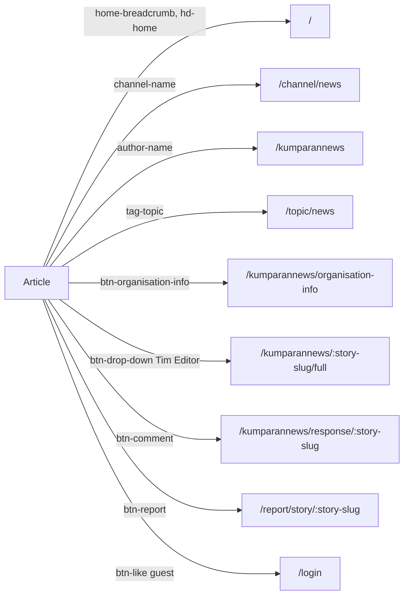

# Article
A reader reads a story and moves on to its channel, author, topic, editors, organisation info, comments or report form.

## Entry points
| Platform | From | Element (data-qa-id) | Lands on |
|---|---|---|---|
| Desktop | home | `author-name` | `/kumparannews/:story-slug/full` |
| Desktop | search | `news-card-gallery-v2`, `author-name` | `/kumparannews/:story-slug` |
| Both | search | `news-card-video-v2` | `/quickpost/:story-slug` |
| Both | home | `promoted-topic` | `/topic/...` (topic page, not an article) |

## Flow

Signed-in path: pending signed-in crawl.

## Expected results (proof it worked)
- `home-breadcrumb` "Beranda" lands on `/` with `headline-card`, `carousel-pane` (FindAllActiveSnaps, FindTrendingStories).
- `channel-name` "News" lands on `/channel/news` (GetHeadlineChannelCount, FindContentFeedByChannelSlug).
- `author-name` lands on `/kumparannews` showing `cover`, `profile-name`, `biography` (FindContentFeed).
- `tag-topic` lands on `/topic/news` showing `topic-name`.
- `btn-organisation-info` lands on `/kumparannews/organisation-info` showing `name`.
- Desktop `btn-drop-down` "Tim Editor" lands on `/kumparannews/:story-slug/full` listing `editor-name`, `editor-role`; mobile only expands the list (`user-list-0`).
- `google-add-preference-button`, `create-story`: no visible effect.

## Desktop vs mobile differences
- `btn-drop-down`: navigates on desktop, changes state in place on mobile.
- Mobile shows burger menu and `hd-search`; desktop shows `input-search`, `hd-theme`, `hd-login`.
- Mobile `btn-report` still lands on `/report/story/:story-slug`.
- Page object: `ArticlePage` (`title`, `author`, `channel`, `topicTags`, `breadcrumbHome`, `likeButton`, `commentButton`, `reportButton`, `shareBar`).

## Test ideas
Positive
- Title, byline, date, body: TC-ART-001. Engagement bar: TC-ART-002. Title and canonical: TC-ART-003. Breadcrumb Home: TC-ART-005.
- Channel, author, topic and organisation-info navigation: NEW.
Negative
- Unknown story URL returns 404 with navigation kept: TC-ART-004.
Boundary
- Like/comment counts of "0" and abbreviated counts (rb, jt) parse correctly: NEW.
Edge
- "Tim Editor" dropdown differs by platform: NEW.
- Story with no topic tag or no editors: NEW.

## Gotchas
- Interstitial ad (`otp-ads-close-modal-btn`) may cover the page; `BasePage.dismissInterstitial` handles it.
- Hydration delay: use `clickUntilUrl`/`clickUntilVisible` for engagement buttons.
- Author link goes to `/kumparannews` here but to `.../full` from home; do not assume one target.

## Gaps
- Signed-in article view (follow, bookmark) not crawled.
- Related stories, ads and in-body media not clicked.
- Video and quickpost article types only seen as landing pages from search.
