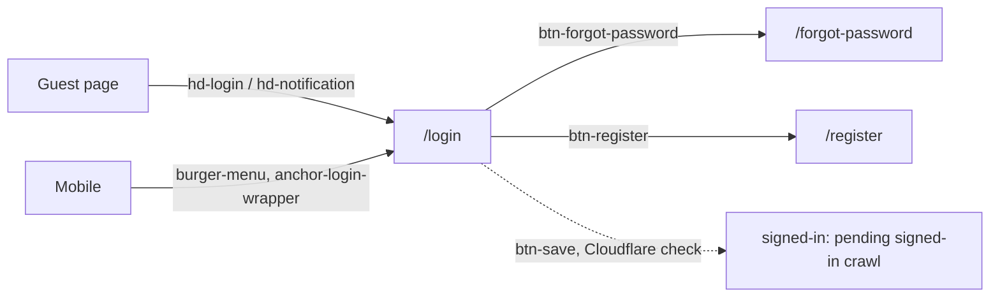

# Auth (login)
A reader signs in with email and password, or via Facebook, Google or phone number; recovery and registration are linked from the same form.

## Entry points
| Platform | From | Element (data-qa-id) | Lands on |
|---|---|---|---|
| Desktop | home, article, comments, report, search | `hd-login` "Masuk" | `/login` |
| Desktop/Mobile | any page | `hd-notification` (guest) | `/login` |
| Desktop/Mobile | article | `btn-like` (guest) | `/login` (fires CreateLike) |
| Mobile | burger menu | `anchor-login-wrapper` | login (listed in the menu overlay; click not recorded) |
| Both | login | `btn-forgot-password` "Lupa Password" | `/forgot-password` |
| Both | login | `btn-register` "Daftar Sekarang!" | `/register` |

## Flow

## Expected results (proof it worked)
- Login entry shows `input-email`, `input-password`, `right-add-on`, `eye` (digest: home `hd-login`).
- `eye` toggles to `eye-off` (digest: login `eye`).
- `btn-forgot-password` goes to `/forgot-password`; `btn-register` goes to `/register`.
- Header `hd-login`/`hd-notification` on `/login` itself: no visible effect.
- Social buttons (`btn-login-fb`, `btn-login-google`, `btn-login-phone`) and `btn-save` are present; the crawler did not activate them (protected).
- Signed-in outcome: pending signed-in crawl.

## Desktop vs mobile differences
- Desktop has `hd-login` "Masuk"; mobile reaches login through the burger menu (`anchor-login-wrapper`) or `hd-notification`.
- Mobile login page has no `hd-theme`, `hd-login` or `create-story` rows.
- Page objects: `LoginPage` (`email`, `password`, `submit`, `togglePasswordVisibility`, `socialLogins`, `hasBotChallenge`), `Header.goToLogin()`.

## Test ideas
Positive
- Login entry opens form: TC-AUTH-001. Password toggle: TC-AUTH-006. Alternative methods and recovery links: TC-AUTH-007.
- Forgot-password and register URL asserts: NEW.
Negative
- Submit disabled with empty fields: TC-AUTH-002 (planned). Malformed email message: TC-AUTH-003 (planned). Cleared password message: TC-AUTH-004 (planned).
- Bot challenge before submit: TC-AUTH-005.
Boundary
- Very long email, whitespace-only password: NEW.
Edge
- Signed-in landing, session persistence, logout: TC-AUTH-017/018 (planned, pending signed-in crawl).
- `hd-login` clicked while already on `/login`: NEW.

## Gotchas
- Login submit is behind a Cloudflare human check: never automate a real submit.
- Mobile: open the burger menu first; `close-sidebar` must be visible.
- `btn-save` is "Masuk" (submit), not a save action.

## Gaps
- Signed-in header, profile menu and logout: pending signed-in crawl.
- Destination of social buttons and phone login, and validation messages: not exercised.
- `/forgot-password` and `/register` contents were not recorded.
