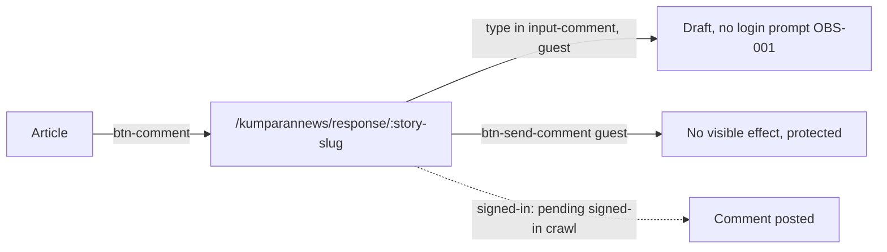

# Comment
A reader opens a story's comment thread and, once signed in, writes a comment; guests can see the thread.

## Entry points
| Platform | From | Element (data-qa-id) | Lands on |
|---|---|---|---|
| Desktop | article | `btn-comment` "0" | `/kumparannews/response/:story-slug` |
| Mobile | article | `btn-comment` "0" | `/kumparannews/response/:story-slug` |

## Flow

## Expected results (proof it worked)
- Thread shows `selected-commented-card`, `comment-input-card`, `input-comment`, `comment-editor-border`, text "Belum ada komentar" (empty story); API FindPinCommentByStoryID.
- Comment count on the article matches the thread (TC-CMT-002).
- `btn-send-comment` as guest: no visible effect (desktop and mobile).
- Header `hd-notification`/`hd-login` on this page lead to `/login`.

## Desktop vs mobile differences
- Desktop comments page has `hd-logo`, `hd-home`, `input-search`, `hd-theme`; mobile has burger menu, `hd-search` and bottom nav (`nb-*`).
- Page object: `CommentPage` (`commentedStory`, `section`, `inputCard`, `input`, `editor`, `sendButton`, `emptyState`).

## Test ideas
Positive
- Comment button opens thread: TC-CMT-001. Count matches thread: TC-CMT-002.
Negative
- Guest typing publishes nothing: TC-CMT-004. Send is never clicked in this project.
Boundary
- Empty and very long drafts, signed-in: TC-CMT-003/005/006 (planned; assert only, no submit).
Edge
- OBS-001: guest can draft a full comment with no login prompt; assert current behavior and flag if it changes.
- Replies, edit, delete, sort: TC-CMT-007/008/009 (planned, signed-in).

## Gotchas
- Never click `btn-send-comment`; the assignment forbids submitting.
- The editor is `textarea#comment-editor` inside `input-comment`.
- `emptyState` (`no-comment`) only exists when the story has zero comments.

## Gaps
- Populated threads, replies, likes on comments, pinned comments.
- Signed-in composer behavior and validation messages.
