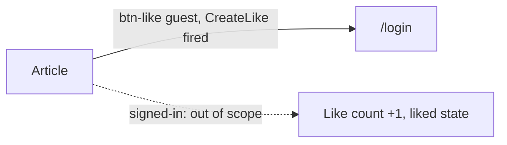

# Like
A reader likes a story from the engagement bar; guests are asked to log in first.

## Entry points
| Platform | From | Element (data-qa-id) | Lands on |
|---|---|---|---|
| Desktop | article | `btn-like` "0" | `/login` (guest) |
| Mobile | article | `btn-like` "0" | `/login` (guest) |
| Both | video story | `btn-like-false`, `like-count` | seen in flow-map only, not clicked |

## Flow

## Expected results (proof it worked)
- Guest click on `btn-like` navigates to `/login` and shows `input-email`, `input-password`, `right-add-on`, `eye`.
- The `CreateLike` GraphQL operation is observed on that click (desktop and mobile).
- Count does not change for the guest (TC-LIKE-004).
- Signed-in outcome: out of scope (signing in needs a person at Cloudflare's "Verify you are human" check).

## Desktop vs mobile differences
- Same result. Mobile also renders `hd-notification`, `notification` while the login view loads.
- Page object: `ArticlePage.likeButton`, `likeCount()`, `isLiked()`, `tapLikeExpectingLogin()`, `toggleLike()`.

## Test ideas
Automated
- Guest tap goes to login and the count does not change: TC-LIKE-004.

Ideas, not automated
- Return to the same story after the login redirect.

Out of scope
- Signed-in like, unlike, persistence after reload and double-tap: out of scope (signing in needs a person at Cloudflare's "Verify you are human" check).

## Gotchas
- `CreateLike` fires even though the user is redirected; do not read it as a successful like.
- `isLiked()` infers state from `aria-pressed` or class names; the real selector is unconfirmed.
- Signed-in likes change real data: use a dedicated test story and undo.

## Gaps
- Signed-in like and unlike behavior, error states and the liked-state markup.
- Whether the login redirect carries a return URL.
