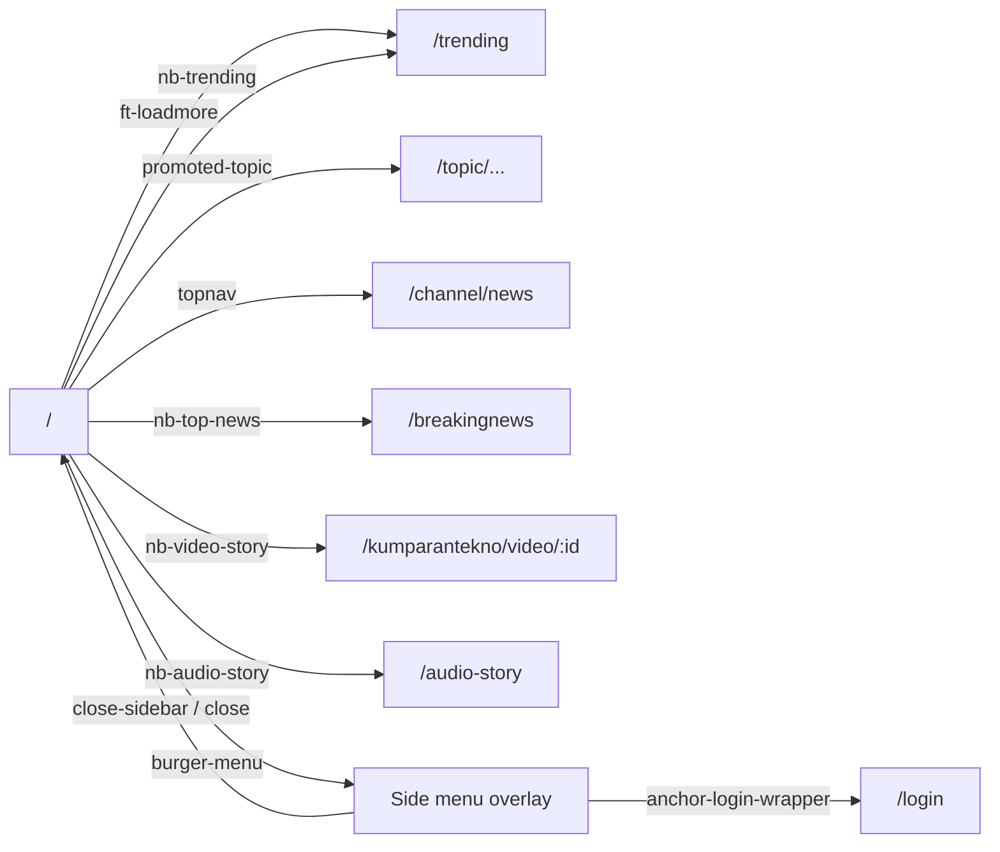

# Navigation
A reader moves around kumparan with the header, the mobile burger menu and bottom nav, and channel/trending/topic links.

## Entry points
| Platform | From | Element (data-qa-id) | Lands on |
|---|---|---|---|
| Both | most pages | `hd-logo`, `hd-home` | `/` |
| Desktop | home | `ft-loadmore` "Lihat lainnya" | `/trending` |
| Desktop | home | `promoted-topic` | `/topic/pimpinan-ponpes-...` |
| Mobile | home | `burger-menu` | overlay (`close-sidebar`, `anchor-login-wrapper`, `profile`) |
| Mobile | home | `nb-top-news` "Breaking News" | `/breakingnews` |
| Mobile | home | `nb-video-story` | `/kumparantekno/video/:id` |
| Mobile | home | `nb-audio-story` | `/audio-story` |
| Mobile | home | `nb-trending` | `/trending` |
| Mobile | home | `topnav` "News" | `/channel/news` |
| Mobile | home | `hd-search` | `/search` |
| Both | any | `hd-theme` | toggles theme (`sun` appears) |

## Flow

## Expected results (proof it worked)
- `/trending` shows `tab-semua`, `tab-item`, `trending-stories-card` (FindCompactStoryBySlug).
- `/channel/news` fires GetHeadlineChannelCount, FindContentFeedByChannelSlug, FindTrendingStoriesByChannelSlug.
- `/breakingnews` shows `breaking-news-hero-card` (FindAllCollectionsQuery); `/audio-story` shows `regular-audio-story-card`.
- Video story page shows `pause-circle`, `volume-x` (FindVideoStoryByID).
- Burger menu shows `close-sidebar`, `anchor-login-wrapper`, `profile`, `ic-new-kumplus-outline-black`.
- Side menu: `list-item-card` "Mode Gelap" and `list-label-tentang-kumparan` show no visible effect in the crawl; `close-sidebar` and `close` update the page.
- `hd-logo` and `hd-home` on home: no visible effect (already there).

## Desktop vs mobile differences
- Desktop: logo, `hd-home`, inline `input-search`, `hd-theme`, `hd-login`. Mobile: burger menu, `hd-search`, `hd-notification`, bottom nav `nb-*`, `topnav`.
- The side-menu page exists on mobile only.
- Page objects: `Header` (`logo`, `searchEntry`, `themeToggle`, `burgerMenu`, `loginEntry`, `openSideMenu()`), `HomePage`.

## Test ideas
Automated
- Homepage loads: TC-HOME-001. Headline opens the article: TC-HOME-002. Usable with ads on: TC-HOME-003.
- Channel menu opens News: TC-NAV-001. Mobile side menu opens and closes: TC-NAV-002, TC-AGT-010. Dark mode survives a reload: TC-NAV-003, TC-AGT-008.
- Trending from "Lihat lainnya" (desktop): TC-NAV-004, TC-AGT-007. Mobile top-nav strip: TC-NAV-006, TC-AGT-011.
- No first-party JavaScript errors: TC-NAV-005 (fails on desktop: BUG-003). Guest bell goes to `/login`: TC-AGT-008.

## Gotchas
- Mobile `ft-loadmore`, `chevron-next`, `arrow-right` and `close` timed out in the crawl (covered or animated); use targeted specs.
- On the side-menu page every row except `close-sidebar`, `list-item-card`, `list-label-tentang-kumparan` and `close` timed out: the overlay covers the page.
- `hd-theme` is `moon` on mobile in `Header`.
- Interstitial ads may block clicks.

## Gaps
- Signed-in menu (profile, bookmarks, logout): out of scope (Cloudflare human check on login).
- "Tentang kumparan" and "Mode Gelap" outcomes not visible to the crawler.
- Carousel controls, footer links and breaking-news destinations beyond landing not covered.
