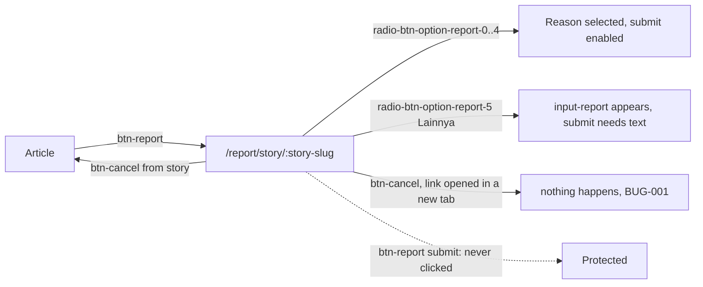

# Report
A reader flags a story to the editors by choosing one of six reasons on the "Laporkan Konten" form.

## Entry points
| Platform | From | Element (data-qa-id) | Lands on |
|---|---|---|---|
| Desktop | article | `btn-report` "Laporkan tulisan" | `/report/story/:story-slug` |
| Mobile | article | `btn-report` "Laporkan tulisan" | `/report/story/:story-slug` |
| Both | direct link | URL | `/report/story/:story-slug` |

## Flow

Signed-in path: out of scope (signing in needs a person at Cloudflare's "Verify you are human" check).

## Expected results (proof it worked)
- The form shows the reported story (`news-item`) and six reasons `radio-btn-option-report-0..5`.
- Reasons: Spam/Komersial/Iklan, pornografi, membahayakan, kekerasan, SARA, Lainnya.
- Reasons 0-4 enable the submit button; "Lainnya" (5) reveals `input-report` and keeps submit disabled until text is written.
- `btn-cancel` "Batal" returns to the story when the form was opened from it.
- `btn-report` "Laporkan" (submit) is protected: asserted only, never clicked.

## Desktop vs mobile differences
- Same reasons and buttons on both. Desktop adds the `hd-*` header and `create-story`; mobile adds the burger menu and top-nav strip.
- BUG-002 (URL reverts to the story while the form is shown) is deterministic on mobile and intermittent on desktop.
- Page object: `ReportPage` (`reason(i)`, `radio(i)`, `cancelButton`, `otherReasonInput`, `submitButton`).

## Test ideas
Positive
- Form opens with six reasons: TC-RPT-001. Each of reasons 0-4 enables submit: TC-RPT-002. "Lainnya" shows the text field: TC-RPT-006; submittable once written: TC-RPT-011.
- Cancel from the story returns to it: TC-RPT-004. Guest completes the form up to submit: TC-RPT-007.

Negative
- Submit disabled with no reason: TC-RPT-003. "Lainnya" with empty text: TC-RPT-010.

Boundary
- Only one reason selectable at a time: TC-RPT-005.

Edge
- Report link for a missing story: TC-RPT-008. Cancel on a report link opened in a new tab (BUG-001): TC-RPT-009. Keyboard user keeps the form URL (BUG-002): TC-RPT-012.

## Gotchas
- NEVER click the submit `btn-report`, and never report anything.
- `btn-report` is the same id for the article entry point and the form submit: always scope to the form.
- The "radio" options are `<input type="checkbox">`; single choice is enforced by script, so assert exclusivity explicitly.
- Wait until the options are wired by React before clicking (`waitForInteractive`): an early click ticks the native checkbox without the app registering it.

## Gaps
- Server response after submit (not allowed by the assignment).
- Signed-in differences, if any: out of scope (signing in needs a person at Cloudflare's "Verify you are human" check).
