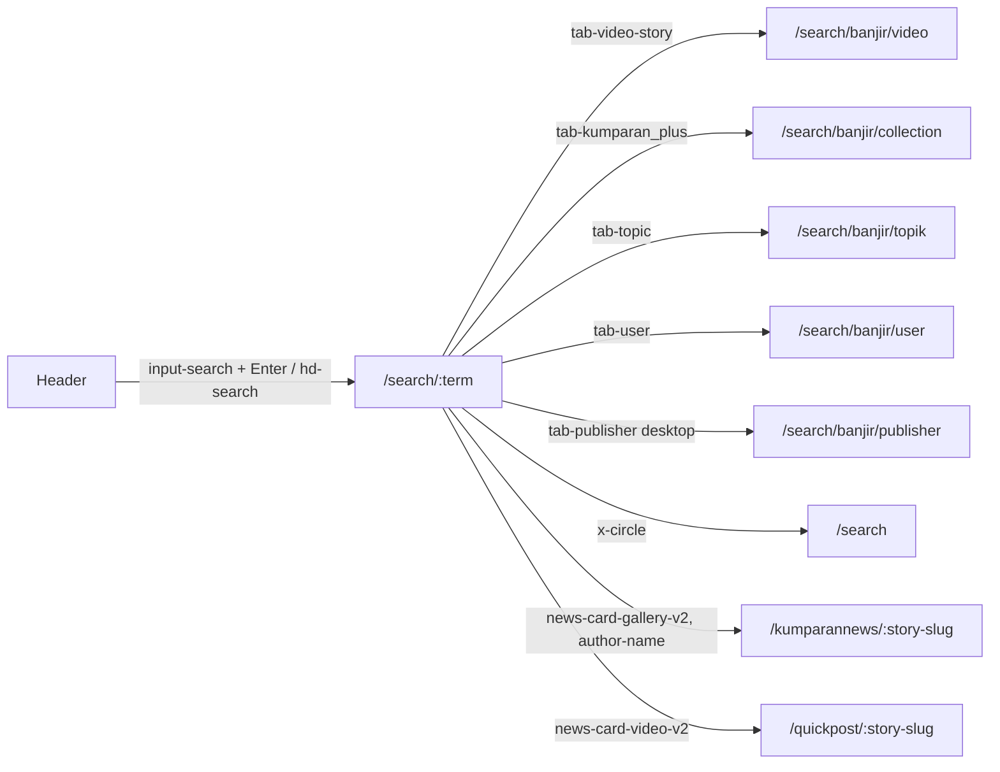

# Search
A reader searches kumparan and browses results by content type, relevance or newest.

## Entry points
| Platform | From | Element (data-qa-id) | Lands on |
|---|---|---|---|
| Desktop | any page | `input-search` "Cari di sini..." | input field, results after Enter |
| Mobile | any page | `hd-search` | `/search` (`input-search`, `popular-list`; FindTrendingSearch) |

## Flow

## Expected results (proof it worked)
- `tab-video-story` shows `video-story-card` (SearchAllContents); `tab-kumparan_plus` shows `collection-card` (SearchAllCollectionsV2Query).
- `tab-topic` shows `search-topic-result-card` (SearchAllTopicsV2); `tab-user` shows `search-user-result-card`, `btn-follow`; `tab-publisher` (desktop) shows `search-publisher-result-card`.
- `newest-non-active` "Terbaru" swaps to `newest-active` and `relevant-non-active` (SearchAllStoriesUnionQuickStories).
- `x-circle` clears to `/search`; desktop shows `popular-list`.
- `tab-story` "Konten" and `relevant-active`: no visible effect (already active).
- Result cards navigate to the story or to `/quickpost/:story-slug`.

## Desktop vs mobile differences
- Mobile has no `tab-publisher` row and no `hd-theme`; `x-circle` on mobile returns to the `/search` landing with the bottom nav.
- Desktop searches inline in the header; mobile opens `/search` first (`Header.search()` handles both).
- Page object: `SearchPage`, `Header.searchEntry`, `Header.search(term)`.

## Test ideas
Positive
- Search a common term and see results: TC-SRCH-001..003 (planned). Tabs switch URL and content: TC-SRCH (planned) / NEW.
- Sort Terbaru then Relevansi: NEW.
Negative
- No-result term shows an empty state: TC-SRCH (planned); exact empty-state text NEW.
Boundary
- Empty query, 1 character, very long query, special characters: NEW.
Edge
- Clear with `x-circle`; term with spaces appears URL-encoded in the path: NEW.
- Result card opens quickpost vs article: NEW.

## Gotchas
- The crawl used the term "banjir"; the URL shape is `/search/<term>/<tab>`.
- Result cards include video quickposts with a different URL pattern.
- Do not click `btn-follow` (account action).

## Gaps
- Empty-result state and suggestions while typing not recorded.
- Pagination or infinite scroll of results not exercised.
- Signed-in search history: pending signed-in crawl.
