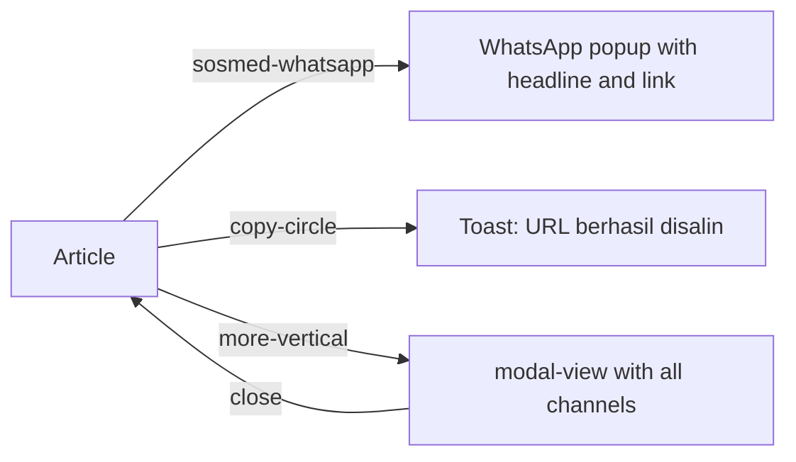

# Share
A reader shares a story through the share bar or the "more" menu (WhatsApp, copy link and other channels).

## Entry points
| Platform | From | Element (data-qa-id) | Lands on |
|---|---|---|---|
| Both | article | `share-wrapper` with `sosmed-whatsapp`, `copy-circle`, `more-vertical` | popup, clipboard or `modal-view` |
| Both | video story | `btn-share` | seen in flow-map only |

## Flow

## Expected results (proof it worked)
- The digest has no click rows for share; `share-wrapper` is listed as an appeared element on article pages in `knowledge/flow-map.json`.
- Outcomes below come from existing specs and `ArticlePage`: WhatsApp popup carries headline and link (TC-SHR-001); copy link shows "URL berhasil disalin" (TC-SHR-003); the menu lists every channel (TC-SHR-002) and closes (TC-SHR-006).
- Shared links are absolute https URLs on kumparan.com (TC-SHR-005).

## Desktop vs mobile differences
- Not established by the crawl. Page object: `ArticlePage.shareBar`, `shareWhatsApp`, `shareCopyLink`, `shareMore`, `shareModal`, `copiedToast`, `openShareMenu()`, `shareVia()`.

## Test ideas
Positive
- WhatsApp share: TC-SHR-001. Menu channels: TC-SHR-002. Copy link: TC-SHR-003. Each channel carries the link: TC-SHR-004.
Negative
- Menu closes with its close button: TC-SHR-006.
Boundary
- Absolute https kumparan.com link: TC-SHR-005.
Edge
- Story with a long or non-ASCII headline in the share text: NEW.

## Gotchas
- Share opens popups to external sites; read the popup URL, do not interact with the external site.
- Clipboard read needs permission in the browser context.

## Gaps
- No digest rows: share element effects were not recorded by the crawler.
- Mobile native share sheet behavior unknown.
- Instagram/TikTok/X channels appear in the map, targets not verified.
