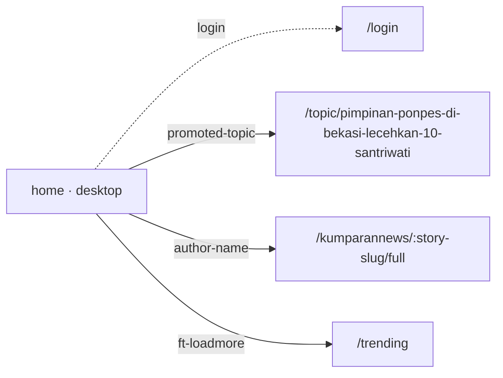
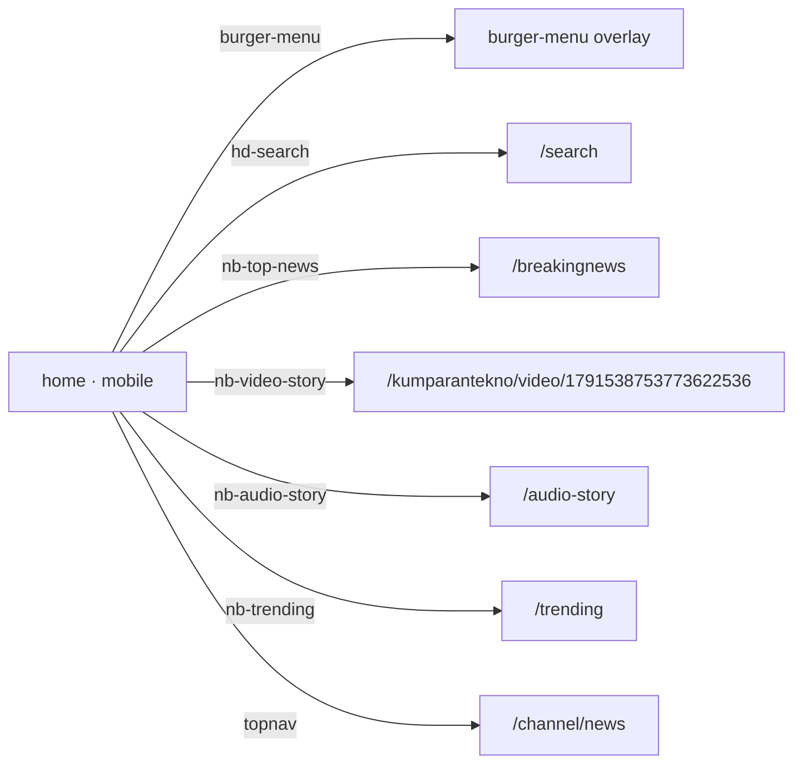
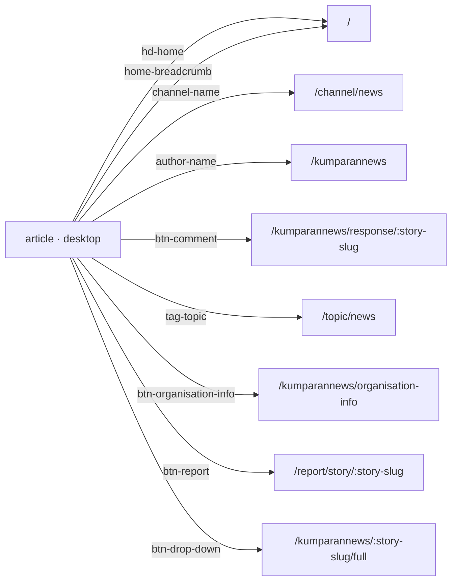
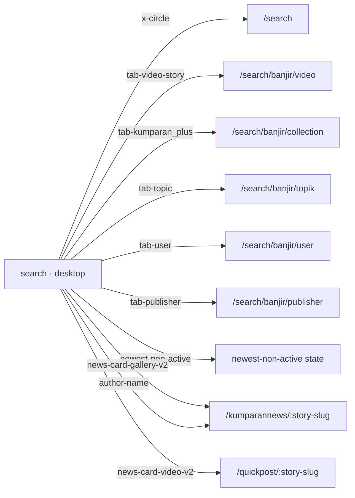
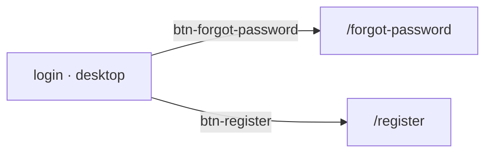

# Flow digest

Generated from the crawler run at 2026-10-09T16:24:17.753Z (sample story `/kumparannews/pintu-krl-bogor-line-gangguan-9-perjalanan-terlambat-hingga-32-menit-28LLu5FefNX`).
Each row is one data-qa-id element clicked in a fresh browser: where it lands, what appears, and which GraphQL operations it fires.
Regenerate with `npm run explore && npm run explore:digest`.

## home

### home · desktop

| Element | View | Effect | Lands on | Appears | API calls |
|---|---|---|---|---|---|
| `hd-logo`  | guest | no visible effect |  |  |  |
| `input-search` "Cari di sini..." | guest | input field |  |  |  |
| `hd-home`  | guest | no visible effect |  |  |  |
| `hd-theme`  | guest | updates page |  | sun |  |
| `hd-notification`  | guest | LOGIN REQUIRED | `/login` | input-email, input-password, right-add-on, eye |  |
| `hd-login` "Masuk" | guest | LOGIN REQUIRED | `/login` | input-email, input-password, right-add-on, eye |  |
| `arrow-right`  | guest | updates page |  | arrow-left |  |
| `promoted-topic` "Pimpinan Ponpes di Bekasi Lece" | guest | navigates | `/topic/pimpinan-ponpes-di-bekasi-lecehkan-10-santriwati` | full-audio-story-player, audio-story-player-cover-image, audio-story-title, start-duration | FindCompactStoryBySlug |
| `author-name` "kumparanNEWS" | guest | navigates | `/kumparannews/:story-slug/full` | home-breadcrumb, channel-name, story-author, story-title | FindEmbeddableStoriesByUserAliasID |
| `ft-loadmore` "Lihat lainnya" | guest | navigates | `/trending` | page-title, tab-semua, tab-item, trending-stories-card | FindCompactStoryBySlug |
| `create-story` "Buat Tulisan" | guest | no visible effect (protected) |  |  |  |

### home · mobile

| Element | View | Effect | Lands on | Appears | API calls |
|---|---|---|---|---|---|
| `burger-menu`  | guest | opens overlay |  | close-sidebar, anchor-login-wrapper, profile, ic-new-kumplus-outline-black |  |
| `hd-search`  | guest | navigates | `/search` | left-add-on, input-search, popular-list | FindTrendingSearch |
| `hd-notification`  | guest | LOGIN REQUIRED | `/login` | input-email, input-password, right-add-on, eye |  |
| `nb-top-news` "Breaking News" | guest | navigates | `/breakingnews` | breaking-news-logo, breaking-news-hero-card, breaking-news-period, breaking-news-title | FindAllCollectionsQuery |
| `nb-video-story` "Video Story" | guest | navigates | `/kumparantekno/video/1791538753773622536` | hand-click, pause-circle, volume-x, comment | FindVideoStoryByID |
| `nb-audio-story` "Audio Story" | guest | navigates | `/audio-story` | regular-audio-story-card, audio-story-card-cover-image, audio-story-card-duration, audio-story-card-title |  |
| `nb-trending` "Trending" | guest | navigates | `/trending` | tab-semua, tab-item, trending-stories-card, news-item | FindCompactStoryBySlug |
| `topnav` "News" | guest | navigates | `/channel/news` | trending-story-item, channel-feed-header, form-select, news-item | GetHeadlineChannelCount, FindContentFeedByChannelSlug, FindTrendingStoriesByChannelSlug |
| `promoted-topic` "Pimpinan Ponpes di Bekasi Lece" | guest | navigates | `/topic/pimpinan-ponpes-di-bekasi-lecehkan-10-santriwati` | editors-pick-title, rangkum-tab, konten-tab, editors-pick-audio-story-player |  |
| `author-name` "kumparanOTO" | guest | navigates | `/kumparannews/:story-slug/full` | home-breadcrumb, channel-name, story-author, story-title | FindEmbeddableStoriesByUserAliasID |

## article

### article · desktop

| Element | View | Effect | Lands on | Appears | API calls |
|---|---|---|---|---|---|
| `input-search` "Cari di sini..." | guest | input field |  |  |  |
| `hd-home`  | guest | navigates | `/` | arrow-right, promoted-topic, carousel-pane, headline-card | FindAllActiveSnaps, FindTrendingStories, FindCompactStoryBySlug |
| `hd-theme`  | guest | updates page |  | sun |  |
| `hd-notification`  | guest | LOGIN REQUIRED | `/login` | input-email, input-password, right-add-on, eye |  |
| `hd-login` "Masuk" | guest | LOGIN REQUIRED | `/login` | input-email, input-password, right-add-on, eye |  |
| `home-breadcrumb` "Beranda" | guest | navigates | `/` | arrow-right, promoted-topic, carousel-pane, headline-card | FindAllActiveSnaps, FindTrendingStories, FindCompactStoryBySlug |
| `channel-name` "News" | guest | navigates | `/channel/news` | promoted-topic, carousel-pane, headline-card, news-item | GetHeadlineChannelCount, FindContentFeedByChannelSlug, FindTrendingStoriesByChannelSlug |
| `author-name` "kumparanNEWS" | guest | navigates | `/kumparannews` | cover, profile-picture, profile-name, biography | FindContentFeed, FindCountFollowerByObjectIDAndObjectType, FindCompactStoryBySlug |
| `google-add-preference-button` "Ikuti kumparan di Google" | guest | no visible effect |  |  |  |
| `btn-like` "0" | guest | LOGIN REQUIRED | `/login` | input-email, input-password, right-add-on, eye | CreateLike |
| `btn-comment` "0" | guest | navigates | `/kumparannews/response/:story-slug` | selected-commented-card, comment-input-card, input-comment, comment-editor-border, "Belum ada komentar" | FindPinCommentByStoryID |
| `tag-topic` "News" | guest | navigates | `/topic/news` | topic-name, news-item, loading-dot | FindCompactStoryBySlug |
| `btn-organisation-info` "Informasi Redaksi" | guest | navigates | `/kumparannews/organisation-info` | name |  |
| `btn-report` "Laporkan tulisan" | guest | navigates | `/report/story/:story-slug` | news-item, radio-btn-option-report-0, radio-btn-option-report-1, radio-btn-option-report-2 |  |
| `btn-drop-down` "Tim Editor" | guest | navigates | `/kumparannews/:story-slug/full` | user-list-0, editor-profpict, editor-name, editor-role |  |
| `create-story` "Buat Tulisan" | guest | no visible effect (protected) |  |  |  |

### article · mobile

| Element | View | Effect | Lands on | Appears | API calls |
|---|---|---|---|---|---|
| `burger-menu`  | guest | opens overlay |  | close-sidebar, anchor-login-wrapper, profile, ic-new-kumplus-outline-black |  |
| `hd-search`  | guest | navigates | `/search` | hd-notification, notification, nb-top-news, nb-video-story | FindChannelsOrderByUserAliasID, FindTrendingSearch |
| `home-breadcrumb` "Beranda" | guest | navigates | `/` | hd-notification, notification, nb-top-news, nb-video-story | FindChannelsOrderByUserAliasID, FindAllActiveSnaps, FindCompactStoryBySlug |
| `channel-name` "News" | guest | navigates | `/channel/news` | hd-notification, notification, nb-top-news, nb-video-story | FindChannelsOrderByUserAliasID, GetHeadlineChannelCount, FindContentFeedByChannelSlug |
| `author-name` "kumparanNEWS" | guest | navigates | `/kumparannews` | hd-notification, notification, nb-top-news, nb-video-story | FindChannelsOrderByUserAliasID, FindContentFeed, FindCountFollowerByObjectIDAndObjectType |
| `google-add-preference-button` "Ikuti kumparan di Google" | guest | no visible effect |  |  |  |
| `tag-topic` "News" | guest | navigates | `/topic/news` | hd-notification, notification, nb-top-news, nb-video-story | FindPinCommentByStoryID, FindCompactStoryBySlug, FindChannelsOrderByUserAliasID |
| `btn-organisation-info` "Informasi Redaksi" | guest | navigates | `/kumparannews/organisation-info` | hd-notification, notification, nb-top-news, nb-video-story | FindRelatedStories, FindPinCommentByStoryID, FindCompactStoryBySlug |
| `btn-report` "Laporkan tulisan" | guest | navigates | `/report/story/:story-slug` | hd-notification, notification, nb-top-news, nb-video-story | FindCompactStoryBySlug, FindChannelsOrderByUserAliasID |
| `btn-drop-down` "Tim Editor" | guest | changes state |  | user-list-0, editor-profpict, editor-name, editor-role | FindPinCommentByStoryID, FindCompactStoryBySlug |
| `btn-like` "0" | guest | LOGIN REQUIRED | `/login` | hd-notification, notification, input-email, input-password | CreateLike |
| `btn-comment` "0" | guest | navigates | `/kumparannews/response/:story-slug` | hd-notification, notification, nb-top-news, nb-video-story | FindChannelsOrderByUserAliasID, FindPinCommentByStoryID |

## comments

### comments · desktop

| Element | View | Effect | Lands on | Appears | API calls |
|---|---|---|---|---|---|
| `hd-logo`  | guest | navigates | `/` | arrow-right, promoted-topic, carousel-pane, headline-card | FindAllActiveSnaps, FindTrendingStories, FindCompactStoryBySlug |
| `input-search` "Cari di sini..." | guest | input field |  |  |  |
| `hd-home`  | guest | navigates | `/` | arrow-right, promoted-topic, carousel-pane, headline-card | FindAllActiveSnaps, FindTrendingStories, FindCompactStoryBySlug |
| `hd-theme`  | guest | updates page |  | sun, "Belum ada komentar" |  |
| `hd-notification`  | guest | LOGIN REQUIRED | `/login` | input-email, input-password, right-add-on, eye |  |
| `hd-login` "Masuk" | guest | LOGIN REQUIRED | `/login` | input-email, input-password, right-add-on, eye |  |
| `create-story` "Buat Tulisan" | guest | no visible effect (protected) |  |  |  |
| `btn-send-comment`  | guest | no visible effect (protected) |  |  |  |

### comments · mobile

| Element | View | Effect | Lands on | Appears | API calls |
|---|---|---|---|---|---|
| `burger-menu`  | guest | opens overlay |  | close-sidebar, anchor-login-wrapper, profile, ic-new-kumplus-outline-black |  |
| `hd-search`  | guest | navigates | `/search` | left-add-on, input-search, popular-list | FindTrendingSearch |
| `hd-notification`  | guest | LOGIN REQUIRED | `/login` | input-email, input-password, right-add-on, eye |  |
| `nb-top-news` "Breaking News" | guest | navigates | `/breakingnews` | breaking-news-logo, breaking-news-hero-card, breaking-news-period, breaking-news-title | FindAllCollectionsQuery |
| `nb-video-story` "Video Story" | guest | navigates | `/kumparantekno/video/1791538753773622536` | hand-click, pause-circle, volume-x, comment | FindVideoStoryByID |
| `nb-audio-story` "Audio Story" | guest | navigates | `/audio-story` | regular-audio-story-card, audio-story-card-cover-image, audio-story-card-duration, audio-story-card-title |  |
| `nb-trending` "Trending" | guest | navigates | `/trending` | tab-semua, tab-item, trending-stories-card, news-item | FindCompactStoryBySlug |
| `topnav` "News" | guest | navigates | `/channel/news` | promoted-topic, headline-carousel, carousel-pane, carousel-slide | GetHeadlineChannelCount, FindContentFeedByChannelSlug, FindTrendingStoriesByChannelSlug |
| `btn-send-comment`  | guest | no visible effect (protected) |  |  |  |

## report

### report · desktop

| Element | View | Effect | Lands on | Appears | API calls |
|---|---|---|---|---|---|
| `hd-logo`  | guest | navigates | `/` | arrow-right, promoted-topic, carousel-pane, headline-card | FindAllActiveSnaps, FindTrendingStories, FindCompactStoryBySlug |
| `input-search` "Cari di sini..." | guest | input field |  |  |  |
| `hd-home`  | guest | navigates | `/` | arrow-right, promoted-topic, carousel-pane, headline-card | FindAllActiveSnaps, FindTrendingStories, FindCompactStoryBySlug |
| `hd-theme`  | guest | updates page |  | sun |  |
| `hd-notification`  | guest | LOGIN REQUIRED | `/login` | input-email, input-password, right-add-on, eye |  |
| `hd-login` "Masuk" | guest | LOGIN REQUIRED | `/login` | input-email, input-password, right-add-on, eye |  |
| `radio-btn-option-report-0` "Spam, Komersial, atau Iklan" | guest | no visible effect |  |  |  |
| `radio-btn-option-report-1` "Memiliki unsur pornografi" | guest | no visible effect |  |  |  |
| `radio-btn-option-report-2` "Membahayakan atau menjurus tin" | guest | no visible effect |  |  |  |
| `radio-btn-option-report-3` "Mengandung konten kekerasan" | guest | no visible effect |  |  |  |
| `radio-btn-option-report-4` "Menyinggung SARA" | guest | no visible effect |  |  |  |
| `radio-btn-option-report-5` "Lainnya" | guest | updates page |  | input-report |  |
| `btn-cancel` "Batal" | guest | navigates | `blank` |  |  |
| `create-story` "Buat Tulisan" | guest | no visible effect (protected) |  |  |  |
| `btn-report` "Laporkan" | guest | no visible effect (protected) |  |  |  |

### report · mobile

| Element | View | Effect | Lands on | Appears | API calls |
|---|---|---|---|---|---|
| `burger-menu`  | guest | opens overlay |  | close-sidebar, close, anchor-login-wrapper, profile |  |
| `hd-search`  | guest | navigates | `/search` | left-add-on, input-search, popular-list, close | FindTrendingSearch |
| `hd-notification`  | guest | LOGIN REQUIRED | `/login` | input-email, input-password, right-add-on, eye |  |
| `nb-top-news` "Breaking News" | guest | navigates | `/breakingnews` | breaking-news-logo, breaking-news-hero-card, breaking-news-period, breaking-news-title | FindAllCollectionsQuery |
| `nb-video-story` "Video Story" | guest | navigates | `/kumparantekno/video/1791538753773622536` | hand-click, pause-circle, volume-x, comment | FindVideoStoryByID |
| `nb-audio-story` "Audio Story" | guest | navigates | `/audio-story` | regular-audio-story-card, audio-story-card-cover-image, audio-story-card-duration, audio-story-card-title |  |
| `nb-trending` "Trending" | guest | navigates | `/trending` | tab-semua, tab-item, trending-stories-card, loading-dot | FindCompactStoryBySlug |
| `topnav` "News" | guest | navigates | `/channel/news` | promoted-topic, headline-carousel, carousel-pane, carousel-slide | GetHeadlineChannelCount, FindContentFeedByChannelSlug, FindTrendingStoriesByChannelSlug |
| `radio-btn-option-report-0` "Spam, Komersial, atau Iklan" | guest | no visible effect |  |  |  |
| `radio-btn-option-report-1` "Memiliki unsur pornografi" | guest | no visible effect |  |  |  |
| `radio-btn-option-report-2` "Membahayakan atau menjurus tin" | guest | no visible effect |  |  |  |
| `radio-btn-option-report-3` "Mengandung konten kekerasan" | guest | no visible effect |  |  |  |
| `radio-btn-option-report-4` "Menyinggung SARA" | guest | no visible effect |  |  |  |
| `radio-btn-option-report-5` "Lainnya" | guest | updates page |  | input-report |  |
| `btn-cancel` "Batal" | guest | navigates | `blank` |  |  |
| `btn-report` "Laporkan" | guest | no visible effect (protected) |  |  |  |

## search

### search · desktop

| Element | View | Effect | Lands on | Appears | API calls |
|---|---|---|---|---|---|
| `hd-logo`  | guest | navigates | `/` | arrow-right, promoted-topic, carousel-pane, headline-card | FindAllActiveSnaps, FindTrendingStories, FindCompactStoryBySlug |
| `input-search` "Cari di sini..." | guest | input field |  |  |  |
| `x-circle`  | guest | navigates | `/search` | popular-list | FindTrendingSearch |
| `hd-home`  | guest | navigates | `/` | arrow-right, promoted-topic, carousel-pane, headline-card | FindAllActiveSnaps, FindTrendingStories, FindCompactStoryBySlug |
| `hd-theme`  | guest | updates page |  | sun |  |
| `hd-notification`  | guest | LOGIN REQUIRED | `/login` | input-email, input-password, eye, btn-forgot-password |  |
| `hd-login` "Masuk" | guest | LOGIN REQUIRED | `/login` | input-email, input-password, eye, btn-forgot-password |  |
| `tab-story` "Konten" | guest | no visible effect |  |  |  |
| `tab-video-story` "Video Story" | guest | navigates | `/search/banjir/video` | video-story-card, video-story-cover, video-duration, video-story-title | SearchAllContents |
| `tab-kumparan_plus` "kumparanPLUS" | guest | navigates | `/search/banjir/collection` | grid-row, collection-card, story-count | SearchAllCollectionsV2Query |
| `tab-topic` "Topik" | guest | navigates | `/search/banjir/topik` | search-topic-result-card, topic-result, cover, name | SearchAllTopicsV2 |
| `tab-user` "Pengguna" | guest | navigates | `/search/banjir/user` | search-user-result-card, user-result, profile-name, btn-follow | SearchAllUsersV2, FindCountFollowerByObjectIDAndObjectType |
| `tab-publisher` "Publisher" | guest | navigates | `/search/banjir/publisher` | search-publisher-result-card, publisher-result, profile-name, btn-follow | SearchAllPublishersV2Query, FindCountFollowerByObjectIDAndObjectType |
| `relevant-active` "Relevansi" | guest | no visible effect |  |  |  |
| `newest-non-active` "Terbaru" | guest | changes state |  | relevant-non-active, newest-active | SearchAllStoriesUnionQuickStories, FindCompactStoryBySlug |
| `news-card-gallery-v2`  | guest | navigates | `/kumparannews/:story-slug` | home-breadcrumb, chevron-next, channel-name, story-author | FindEmbeddableStoriesByUserAliasID |
| `author-name` "kumparanNEWS" | guest | navigates | `/kumparannews/:story-slug` | home-breadcrumb, chevron-next, channel-name, story-author | FindEmbeddableStoriesByUserAliasID |
| `news-card-video-v2`  | guest | navigates | `/quickpost/:story-slug` | collection-news-card, breaking-news-author, author, author-verified, "Belum ada komentar" | ObtainStoryStatistics, FindContentFeedByChannelSlug, FindVideoByID |
| `create-story` "Buat Tulisan" | guest | no visible effect (protected) |  |  |  |

### search · mobile

| Element | View | Effect | Lands on | Appears | API calls |
|---|---|---|---|---|---|
| `burger-menu`  | guest | opens overlay |  | close-sidebar, anchor-login-wrapper, profile, ic-new-kumplus-outline-black |  |
| `hd-search`  | guest | navigates | `/search` | nb-top-news, nb-video-story, nb-audio-story, nb-trending | FindChannelsOrderByUserAliasID, FindTrendingSearch |
| `hd-notification`  | guest | LOGIN REQUIRED | `/login` | input-email, input-password, eye, btn-forgot-password |  |
| `input-search` "Cari di sini..." | guest | input field |  |  |  |
| `x-circle`  | guest | navigates | `/search` | nb-top-news, nb-video-story, nb-audio-story, nb-trending | FindChannelsOrderByUserAliasID, FindTrendingSearch |
| `tab-story` "Konten" | guest | no visible effect |  |  |  |
| `tab-video-story` "Video Story" | guest | navigates | `/search/banjir/video` | video-story-card, video-story-cover, video-duration, video-story-title | SearchAllContents |
| `tab-kumparan_plus` "kumparanPLUS" | guest | navigates | `/search/banjir/collection` | grid-row, collection-card, story-count | SearchAllCollectionsV2Query |
| `tab-topic` "Topik" | guest | navigates | `/search/banjir/topik` | search-topic-result-card, topic-result, cover, name | SearchAllTopicsV2 |
| `tab-user` "Pengguna" | guest | navigates | `/search/banjir/user` | search-user-result-card, user-result, profile-name, btn-follow | SearchAllUsersV2, FindCountFollowerByObjectIDAndObjectType |
| `relevant-active` "Relevansi" | guest | no visible effect |  |  |  |
| `newest-non-active` "Terbaru" | guest | changes state |  | relevant-non-active, newest-active | SearchAllStoriesUnionQuickStories, FindCompactStoryBySlug |
| `news-card-gallery-v2`  | guest | navigates | `/kumparannews/:story-slug` | home-breadcrumb, chevron-next, channel-name, story-author | FindEmbeddableStoriesByUserAliasID |
| `author-name` "kumparanNEWS" | guest | navigates | `/kumparannews/:story-slug` | home-breadcrumb, chevron-next, channel-name, story-author | FindEmbeddableStoriesByUserAliasID |
| `news-card-video-v2`  | guest | navigates | `/quickpost/:story-slug` | nb-top-news, nb-video-story, nb-audio-story, nb-trending, "Belum ada komentar" | FindChannelsOrderByUserAliasID, ObtainStoryStatistics, FindContentFeedByChannelSlug |

## login

### login · desktop

| Element | View | Effect | Lands on | Appears | API calls |
|---|---|---|---|---|---|
| `hd-logo`  | guest | navigates | `/` | arrow-right, promoted-topic, carousel-pane, headline-card | FindAllActiveSnaps, FindTrendingStories, FindCompactStoryBySlug |
| `input-search` "Cari di sini..." | guest | input field |  |  |  |
| `hd-home`  | guest | navigates | `/` | arrow-right, promoted-topic, carousel-pane, headline-card | FindAllActiveSnaps, FindTrendingStories, FindCompactStoryBySlug |
| `hd-theme`  | guest | updates page |  | sun |  |
| `hd-notification`  | guest | no visible effect |  |  |  |
| `hd-login` "Masuk" | guest | no visible effect |  |  |  |
| `input-email` "Email" | guest | input field |  |  |  |
| `input-password` "Password" | guest | input field |  |  |  |
| `eye`  | guest | updates page |  | eye-off |  |
| `btn-forgot-password` "Lupa Password" | guest | navigates | `/forgot-password` |  |  |
| `btn-register` "Daftar Sekarang!" | guest | navigates | `/register` |  |  |
| `create-story` "Buat Tulisan" | guest | no visible effect (protected) |  |  |  |
| `btn-save` "Masuk" | guest | no visible effect (protected) |  |  |  |
| `btn-login-fb` "Facebook" | guest | no visible effect (protected) |  |  |  |
| `btn-login-google` "Google" | guest | no visible effect (protected) |  |  |  |
| `btn-login-phone` "Nomor Handphone" | guest | no visible effect (protected) |  |  |  |

### login · mobile

| Element | View | Effect | Lands on | Appears | API calls |
|---|---|---|---|---|---|
| `burger-menu`  | guest | opens overlay |  | close-sidebar, close, anchor-login-wrapper, profile |  |
| `hd-search`  | guest | navigates | `/search` | nb-top-news, nb-video-story, nb-audio-story, nb-trending | FindChannelsOrderByUserAliasID, FindTrendingSearch |
| `hd-notification`  | guest | no visible effect |  |  |  |
| `input-email` "Email" | guest | input field |  |  |  |
| `input-password` "Password" | guest | input field |  |  |  |
| `eye`  | guest | updates page |  | eye-off |  |
| `btn-forgot-password` "Lupa Password" | guest | navigates | `/forgot-password` |  |  |
| `btn-register` "Daftar Sekarang!" | guest | navigates | `/register` |  |  |
| `btn-save` "Masuk" | guest | no visible effect (protected) |  |  |  |
| `btn-login-fb` "Facebook" | guest | no visible effect (protected) |  |  |  |
| `btn-login-google` "Google" | guest | no visible effect (protected) |  |  |  |
| `btn-login-phone` "Nomor Handphone" | guest | no visible effect (protected) |  |  |  |

## side-menu

### side-menu · mobile

| Element | View | Effect | Lands on | Appears | API calls |
|---|---|---|---|---|---|
| `close-sidebar`  | guest | updates page |  |  |  |
| `list-item-card` "Mode Gelap" | guest | no visible effect |  |  |  |
| `list-label-tentang-kumparan` "Tentang kumparan" | guest | no visible effect |  |  |  |
| `close`  | guest | updates page |  |  |  |

## Not exercisable by the crawler

Usually covered or animated elements (carousel controls, hidden drawers). Covered by targeted specs instead where they matter.

- mobile / home / `ft-loadmore`: locator.click: Timeout 6000ms exceeded.
- mobile / home / `chevron-next`: locator.click: Timeout 6000ms exceeded.
- mobile / home / `arrow-right`: locator.click: Timeout 6000ms exceeded.
- mobile / home / `close`: locator.click: Timeout 6000ms exceeded.
- mobile / article / `close`: locator.click: Timeout 6000ms exceeded.
- mobile / comments / `close`: locator.click: Timeout 6000ms exceeded.
- mobile / search / `close`: locator.click: Timeout 6000ms exceeded.
- mobile / side-menu / `burger-menu`: locator.click: Timeout 6000ms exceeded.
- mobile / side-menu / `hd-search`: locator.click: Timeout 6000ms exceeded.
- mobile / side-menu / `hd-notification`: locator.click: Timeout 6000ms exceeded.
- mobile / side-menu / `nb-top-news`: locator.click: Timeout 6000ms exceeded.
- mobile / side-menu / `nb-video-story`: locator.click: Timeout 6000ms exceeded.
- mobile / side-menu / `nb-audio-story`: locator.click: Timeout 6000ms exceeded.
- mobile / side-menu / `nb-trending`: locator.click: Timeout 6000ms exceeded.
- mobile / side-menu / `topnav`: locator.click: Timeout 6000ms exceeded.
- mobile / side-menu / `promoted-topic`: locator.click: Timeout 6000ms exceeded.
- mobile / side-menu / `ft-loadmore`: locator.click: Timeout 6000ms exceeded.
- mobile / side-menu / `author-name`: locator.click: Timeout 6000ms exceeded.
- mobile / side-menu / `chevron-next`: locator.click: Timeout 6000ms exceeded.
- mobile / side-menu / `arrow-right`: locator.click: Timeout 6000ms exceeded.
